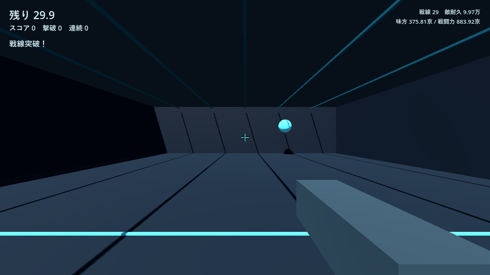
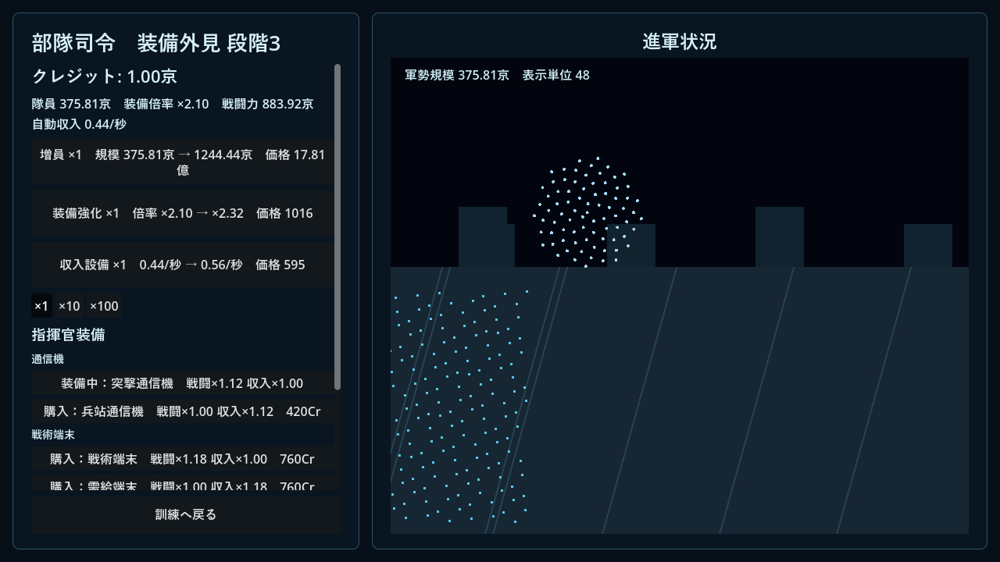
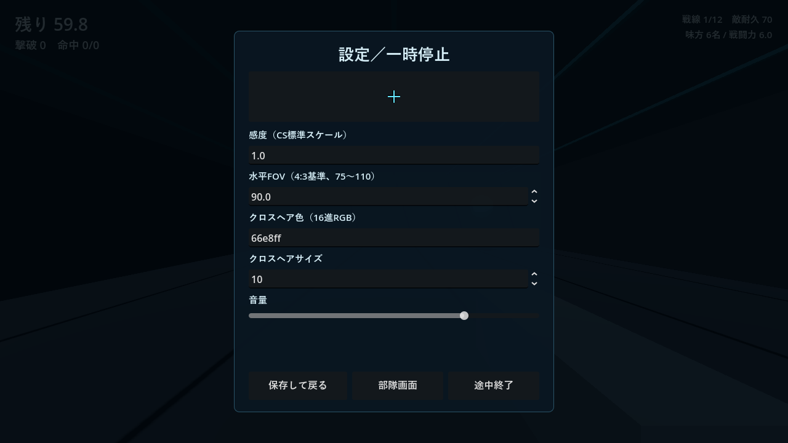
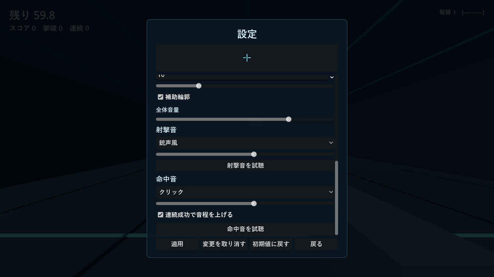

# SUPPLY LINE TRAINER

エイム訓練でクレジットを稼ぎ、自動戦闘する部隊を強化する小規模3Dゲームです。クレジットは訓練結果からのみ獲得できます。

## 起動

[Releases](../../releases) からWindows版ZIPをダウンロードして展開し、`SupplyLineTrainer.exe` を起動してください。同じフォルダーの `SupplyLineTrainer.pck` が必要です。Windows 10/11 64bit向けです。

## 操作

- WASD: 移動
- マウス: 視点
- 左クリック: 射撃
- Esc: 訓練中のみ一時停止

準備画面で武器・難易度・30秒／60秒／時間無制限を選び、「訓練開始」を押します。選択中の項目はチェック表示され、未開放武器には開放条件が表示されます。ハンドガンは単発、オートライフルは長押し連射、バーストライフルは1クリック3発です。訓練中のEscメニューから、その時点の成果を精算して途中終了できます。HUDの「今回の獲得」は今終了しても受け取れるクレジットです。無制限では経過時間を表示します。

中心精度は射線と標的中心との距離から判定します。中心命中は基本点の最大2倍、速さ・連続成功は別途基本点の20%を上限に加算します。クレジットは有効な射撃成果に比例し、無操作の経過時間だけでは増えません。武器ごとに換算率を調整し、訓練時間による固定ボーナスはありません。加点時はスコアが短く明るくなり、中心命中は表示と控えめな音の変化で伝えます。

「練習記録」から、更新後の累計練習時間、射撃活動時間、練習回数と直近200件の履歴を確認できます。時間無制限の累計も別に表示します。一時停止は含めず、射撃活動はオートの射撃中、単発・バーストの各発射後0.2秒を重複なしで数えます。履歴はページ切り替え式で、200件を超えても累計は保持します。

「部隊画面」では、増員と装備強化を行い、ピクセル兵士の隊列と進軍を確認できます。購入数は×1／×5／×10です。指揮官装備は小さな専用パネルで購入・装備します。敵の被弾・退場は実際の耐久減少を5区分に分けた表示です。戦線突破時は隊列と背景が前進し、制圧率と現在の戦闘力から求める突破見込みを表示します。見込みは強化によって更新されます。自動戦闘は進みますが、起動時間、放置、戦線突破からクレジットは発生しません。

| 初期部隊 | 成長後の部隊 |
| --- | --- |
|  |  |

設定画面はCS:GO／VALORANT／Apex Legends基準の腰だめ感度、DPIとcm/360、4:3基準FOV、4種類のクロスヘア、色・サイズ・補助輪郭に対応しています。射撃音と命中音はそれぞれ3種類と「なし」から選択でき、個別音量、試聴、連続成功による控えめな音程上昇を設定できます。音はゲーム内で合成しており、外部音源は使用していません。

## 開発環境

- Godot Engine 4.7.2 stable
- GDScript
- GL Compatibility renderer
- 外部アセット／プラグインなし

プロジェクト編集時は `project.godot` をGodot 4.7.2で開いてください。主要な調整値は `balance.gd` に集約しています。

## 検証

実施済みの検証内容と未確認事項は [VERIFY.md](VERIFY.md) に記載しています。テスト用スクリプトはゲーム本体の書き出し対象から除外されています。

## 更新履歴

各バージョンの変更点は [CHANGELOG.md](CHANGELOG.md) にまとめています。

## 保存

進行、時間別の自己ベスト、設定、指揮官装備はGodotのユーザーデータ領域に `save_v1.json` として自動保存されます。v1.3.0では既存のversion 4セーブの育成をリセットしません。初回読込で `save_before_training_v3.json` を作り、新採点の記録を `bests_v3` に分離します。旧採点の `bests_v2` は保管しますが、新しい自己ベストとは比較しません。version 3以前からの旧来のversion 4移行では、従来どおりバックアップして育成をリセットする処理が残っています。

訓練成果・報酬・累計は15秒ごと、一時停止時、終了時に同じ累積記録として保存します。定期保存済み報酬を終了時に二重加算しません。異常終了後は最後に保存された練習を「中断復元」として確定し、履歴とクレジットを保持します。保存間隔の直近最大15秒程度は失われる場合があります。通常のウィンドウ終了ではその時点まで精算します。保存失敗は画面に表示し、再試行します。

戦線は継続生成されますが、部隊人数は初期6人から増員ごとに4人ずつ増える通常範囲の整数です。街・地球・銀河などの巨大規模演出と指数的人数増加は通常進行から削除しました。

## 既知の制約

- Godot 4.7.2の `InputEventMouseMotion.screen_relative` を優先し、利用できないイベントでは `relative` を使用します。入力差分へdeltaTimeやDPIは掛けませんが、物理マウスカウントとの完全一致は実機比較が必要です。
- UIは論理Viewportとアンカーを基準に追従します。Windows表示倍率100%以外での実機操作は未確認です。
- 感度一致は同じDPIでのcm/360を対象とし、FOVの見かけ、ADS、反動、入力遅延は再現対象外です。
- 実機での長時間プレイによる経済バランスは、計算シミュレーションで調整した目安です。
