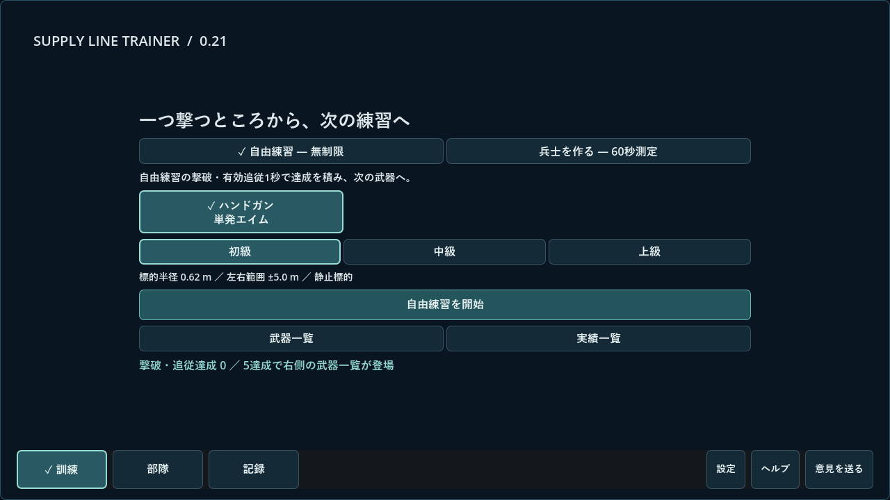
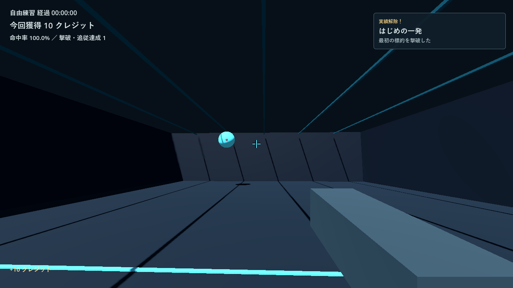
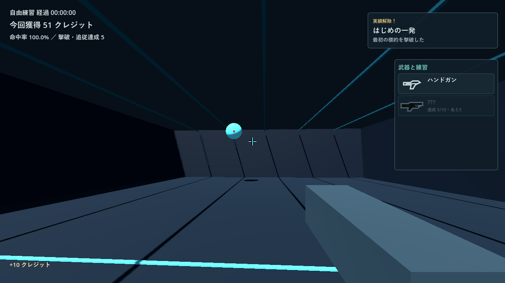
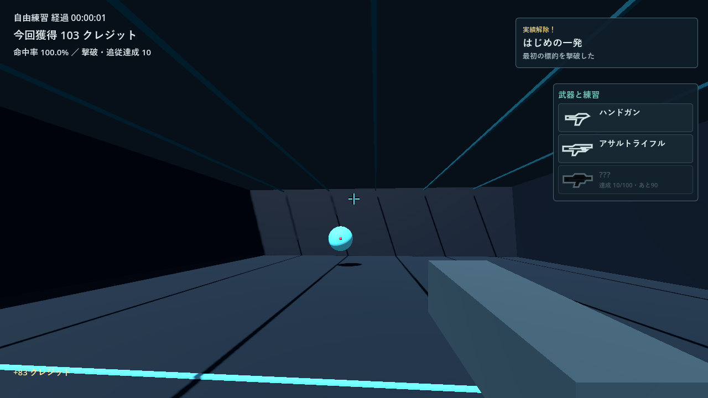
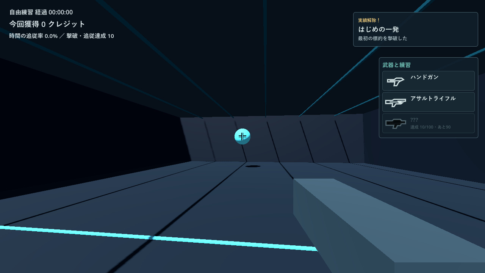
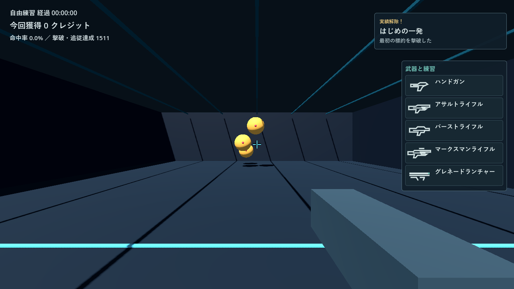
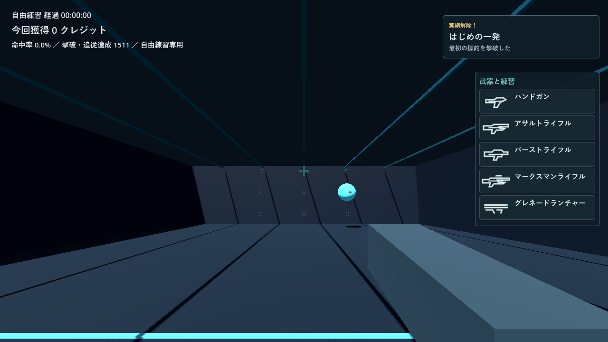
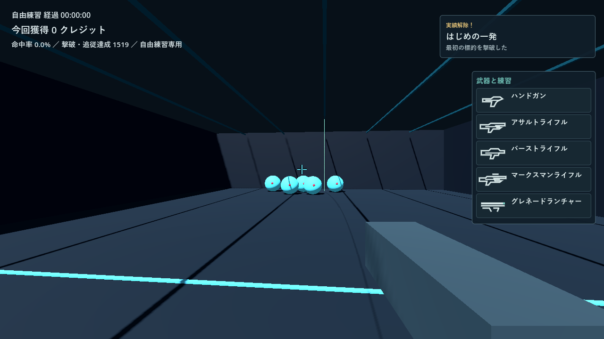
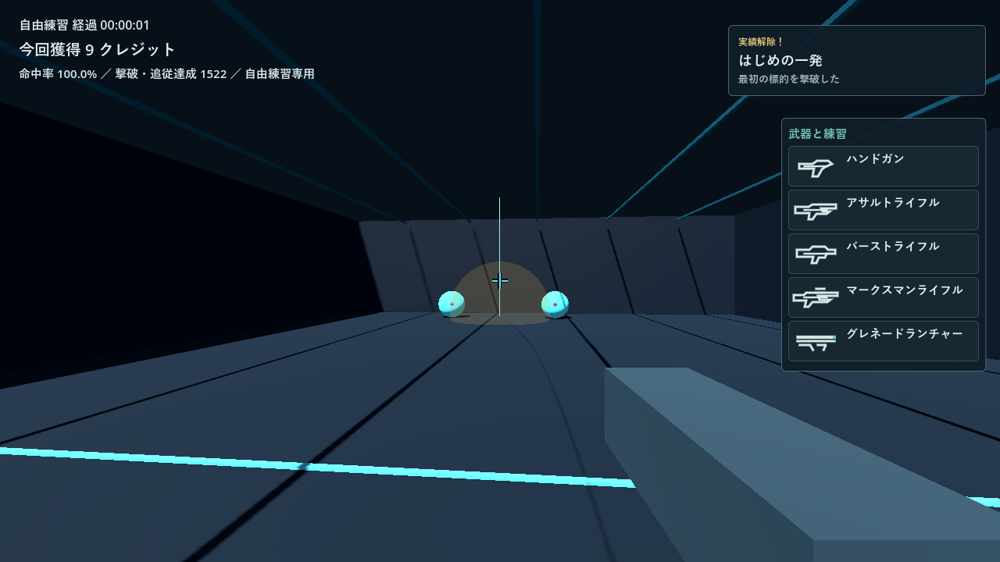
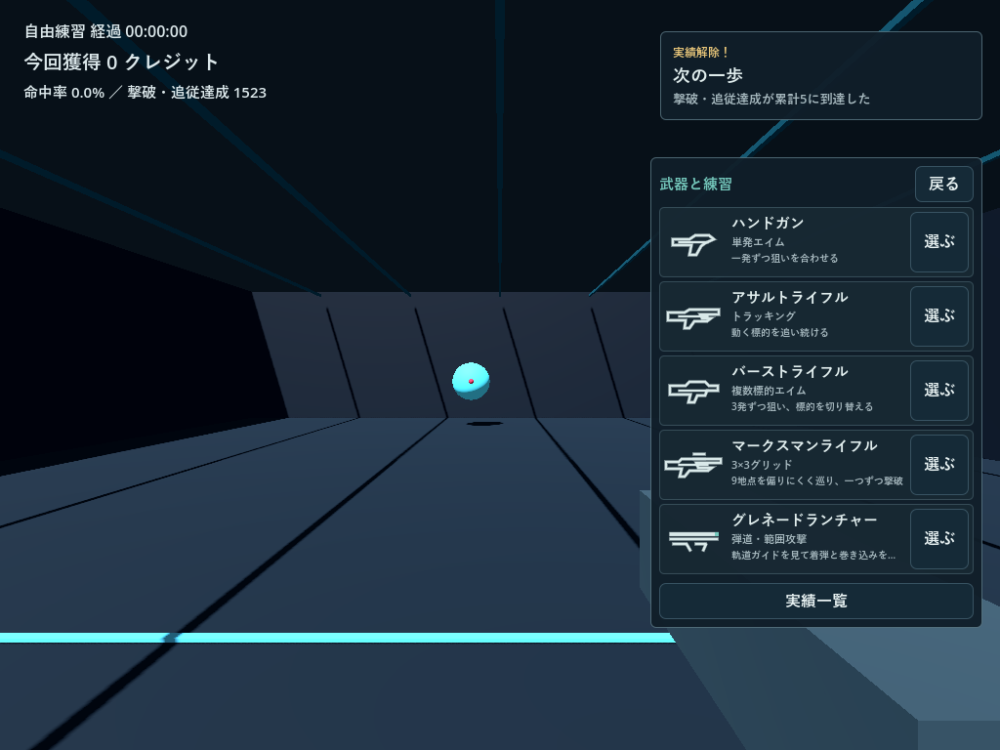

# 0.21 実装・検証報告

2026-11-06。開始基準は公開v2.0.0、main HEAD `9ccce7a`、未コミット変更なし。ユーザーの明示指示でWindowsを実装・保存・検証先とした。番号変更による育成・設定リセットは行わない。

## 範囲と初期値

HG、AR、BR、3×3グリッド、グレネードの五つを実装した。名前・アイコンだけの追加ではない。新二種目は自由練習専用で、兵士は既存三武器各1枠のまま。解放条件0／10／100／500／1,500の初期値は維持した。初見の人による所要時間調整は未実施。

達成は非ARの撃破体数＋AR有効追従累計秒の整数部分。端数をセッション間で保存する。自由練習は達成境界の差分チェックポイント、測定は有効な60秒完了で全量確定。空撃ち、未撃破の命中、再現・試射・自動戦闘は除外する。解除と既読は別に保存し、保存済みの解除だけを通知へ渡す。

グリッドはx=-3/0/3m、y=1/2.5/4m、z=-8mの固定9地点。有効標的一つ、9地点シャッフルで連続同地点なし。半径0.62m、単発最短0.24秒。中心精度・命中率・標的出現から撃破までの平均切替時間を結果に表示する。

GLは初速16m/s＋上向き3.8m/s、重力9.8m/s²、最短0.8秒、同時3発。ガイドと実弾は同じ積分・衝突関数を使う。見えている床・壁の範囲と標的への最初の衝突で一度爆発。半径2.2m、標的HP100へ100ダメージを適用する。直撃・爆風IDを分け、同一対象へ一度だけダメージ。射場外の4秒寿命切れは爆発せず、命中・報酬・達成なしで消滅する。効果12個、保存着弾イベント2,000件に制限した。

GLの命中弾の成果は6＋撃破数、最大9クレジット。命中弾数は一発につき最大1。最短間隔だけの理論上限でも11.25クレジット/秒で、従来HGの中心命中約9.45＋速度等、AR最大約10/秒という尺度と比較した。大幅な稼ぎ専用倍率を付けていない。これは計算上の比較で、人の稼ぎや疲労の評価ではない。

右一覧のための自由練習出現領域は開始時から確保し、登場時にViewport・FOV・条件を変えない。60秒測定条件は従来のまま。自由練習は`practice-021`条件キーで旧配置の記録と比較せず、古い採用プロフィールを再計算しない。

## 保存・番号移行

`save_v2.json`と保存版2を維持し、`progression`だけを後方互換で追加。履歴の互換な撃破・追従の事実をIDごとに一度集計し、得点から推測しない。使用済み三武器の利用権を保存し、移行解除は既読にして大量通知しない。プロフィール・名前・防具・防護・クレジット・有効設定を維持する。[中核契約](021-core.md)。

`ReleaseVersion`を正本とし、新しい連番世代を旧体系より優先。旧2.0.0→0.21、0.21→0.22、0.29→0.30、新版から旧体系へ逆戻りしない比較を検証した。タグ`v0.21`、ZIP`SupplyLineTrainer_Windows_v0.21.zip`を使用し、旧配布を上書きしない。

公開済み旧アップデーターは新番号を認識できないため、旧版からはゲーム終了後に新ZIPを別フォルダーへ手動展開・起動する。セーブの削除・再初期化は不要。

## 自動検証と実描画

- `progression_tests`：1/5/9/10/100/500/1,500、AR端数、有効測定のみ確定、除外、保存失敗各段階と再試行・再起動、旧事実移行、既読、JSON復元後の既存武器維持。
- `release_version_tests`・`updater_tests`：新旧世代、整数連番、表示・正規化、旧形式誤認、ZIP・サイズ・SHA-256・通信失敗。
- `v2_core_tests`：既存中核78件、失敗0。兵士・確率・位相・保存・二重精算の回帰。
- `v2_integration_tests`：使用済み三武器の隔離fixtureで、実射線、測定終端、再現、停止・部隊・設定・採用と失敗を確認。
- `v2_boundary_tests`：26件。入力時刻、短入力、解析レイ、モデル保持数、保存失敗と遷移。
- `scoring_regression_tests`：同一標的配置・射線で旧v1.9.0と新版の三武器stats・得点内訳・端数・q合計／積分が完全一致。出現配置そのものを同一とする試験ではない。
- `review_021_tests`：独立Sol作成の30件を主担当でも実行し全通過。再ロック、表示位置同期、非表示標的、グリッド900巡回、GL直撃・床・壁・高所・射場外・期限切れ・爆風・命中弾数・上限、切替連打・入力解除、通知キュー・停止。
- `integration_021_tests`：新規の実射線で最初の1/5/9/10達成、空撃ち、AR端数、途中測定除外、切替、五種目、GL多撃破、保存失敗の再試行、三解像度のボタン・パネル・文字領域・マウス透過。解放後の画像には明示した隔離fixtureを使い、実進行を変えていない。

Windows／Godot4.7.2／RTX4060／OpenGL Compatibilityで、1280×720・1920×1080・1024×768の初期画面・実績・一覧・実績一覧・設定、五種目と新二種目の結果を実描画して画像を確認した。パネル境界だけでは見落とした武器名の高さ0、一覧幅不足、フィードバック折返しを修正し、文字領域の検査を追加した。

## 分担・独立レビュー

明示したSol6.1が進行・保存・版番号・更新、Luna6.0が定義済みモデルを表示する通知・一覧・アイコンに限定して補助、別Sol6.1が独立レビューした。Astraは使用していない。同じ主要ファイルの並行編集を避けた。

独立レビューでJSON復元後の再ロック、物理tick遅れの誤命中を再現し、修正を再確認。有限な床・壁と空中寿命切れの指摘も修正した。追加30検査は主担当が実行済み。独立レビューモデルは最後の再実行で利用上限に達したため、最後の追加検査の実行者を偽らない。

## 未確認事項

人の長時間試遊、500／1,500条件の体感、音の疲れにくさ、別PC・高DPI・複数モニター、Mac実行、実電源断、旧版での自動差し替え全工程は未確認。自動検証・合成例を面白さや技能向上の実証とは扱わない。

## 配布物と追加確認

GodotのWindowsリリース書き出しでEXE/PCKを作成。最終PCKを直接使ったGPU統合は407検査通過。実セーブの別名バックアップを隔離コピーして読み込み、クレジット・プロフィール・防具・防護・名前・設定の保持、元コピーのハッシュ不変、一度だけの進行移行を確認した。実セーブへテスト状態を注入していない。

最終PCKの本番保存経路でも三武器の測定・採用と新二武器の射撃を保存。別プロセス再起動で五種目の履歴、測定回数各1、採用3件、40クレジット、進行・GL着弾が復元した。解放用1,500達成は隔離fixtureであり、通常プレイの成果ではない。入力・時計は自動駆動で、人が60秒を操作した結果とは区別する。

通常EXEも隔離APPDATAで表示起動し、保存ファイル生成とログにSCRIPT ERROR／ERRORなしを確認した。画面操作ツールは従来API・別の提供APIとも初期化時に`failed to write kernel assets: 指定されたパスが見つかりません。 (os error 3)`で失敗。通常EXEをクリックしての測定・採用・切替は確認済みとしない。自分の隔離検証インスタンスだけを終了した。

ZIPは38,349,334バイト、SHA-256は`8083246247f5d1510759fb0ad03a9aea93413eefcc4b1a94e02ecff7d9b8d2f3`。EXE/PCK、日本語README・CHANGELOG・検証範囲、Godotライセンスだけを同階層に収録した。セーブ・画像・テスト・認証情報を含めない。全メンバーを読み戻し、EXE/PCKが元ビルドのハッシュと一致。更新機能のZIP検証も受理した。

2026-11-06に[PUBLICの0.21リリース](https://github.com/cloford/supply-line-trainer/releases/tag/v0.21)を公開。製品タグは`v0.21`、コミットは`cde2354`。GitHubの最新リリースAPIが0.21を返し、公開アセットのサイズ・digestも上記と一致した。最終PCKの`public_release_tests.gd`でAPI/CDNのリダイレクトを含め実ダウンロードし、サイズ・SHA-256・アーカイブ内容が通過した。旧版番号を与えた新版検査器の更新検出も通過したが、公開済み旧バイナリが新番号を認識するという意味ではない。適用・再起動は実行していない。

最終PCKの`update_display_tests.gd -- --live`も通過。実行中v0.21と最新公開版v0.21が同じと表示され、準備／設定の二解像度で適用ボタンが無効だった。[フィードバック窓口](https://github.com/cloford/supply-line-trainer/discussions/9)も0.21専用で作成した。

## 画面例

隔離状態・自動入力による配布PCK描画。解放後はfixtureを使用した。

