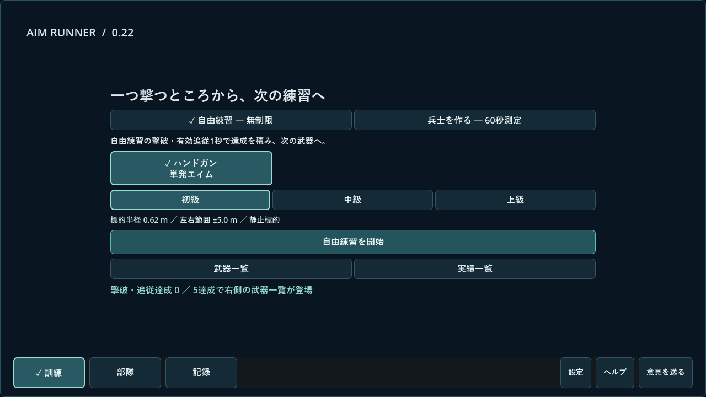
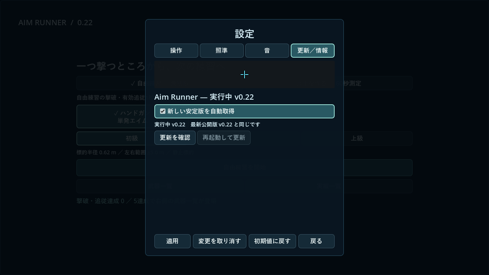

# Aim Runner 0.22 実装・検証

2026-11-06。0.21の公開後、製品名変更・版別Discussion・過去版からの更新内容を整備した。Windowsで実装・配布するユーザー指示を継続して適用した。

## 変更内容

- 製品名をAim Runnerへ変更。`project.godot`、`next_game.gd`、`v2_interface.gd`、継承元`main.gd`の設定見出し、Windows製品リソースを更新した。
- Windowsのカスタム保存先を`Godot/app_userdata/Supply Line Trainer`へ固定。製品名変更後も`%APPDATA%/Godot/app_userdata/Supply Line Trainer/save_v2.json`を使用する。セーブをコピー・初期化する移行は追加しない。
- 公開番号0.22。`ReleaseVersion`の内部版変換で0.21固定だった要素を現在の公開番号から導出する。旧三要素と新二要素の区別を維持する。
- 0.21の既存Discussion #9を保持し、v2.0.0からの変更点と次版への更新案内を追記。過去の公開リリースに専用スレッドがなかった1.0.0、1.1.0、1.2.0、1.6.1も作成した。0.22は#14。全公開版を[更新内容とDiscussion一覧](versions.md)から参照できる。
- GitHubの説明・README・変更履歴をAim Runnerへ更新。互換性のためGitHubのURL、EXE/PCK/更新ZIP名に旧識別名を維持した。公開済みタグや配布ファイルを上書きしない。
- 射撃・採点・価格・部隊進行・解放条件は0.21と同じ。数値の調整は行っていない。

## 独立レビューで確認した既存の更新不具合

別のSol 6.1が独立レビュー。名称変更と保存先に重大な指摘はなかったが、公開0.21の`update_apply.ps1`が三要素番号しか受け付けないため、`updater.gd`の二要素`manifest.version="0.22"`を`Invalid update metadata`で拒否することを確認した。

0.22では`ValidVersion`を追加し、旧三要素、または0.21以上の二要素だけを許可する。先頭ゼロ・末尾改行・接尾辞・過大桁数は拒否する。公開済み0.21の補助スクリプトには修正が届かないため、**0.21→0.22も手動ZIP更新が必要**とREADME・リリース・Discussionに明記した。セーブ削除は不要。

## 実行済み確認

- Godot 4.7.2でWindows EXE/PCKを書き出し。
- `branding_tests.gd`をソース・最終PCKで実行。Aim Runner 0.22、準備・設定の製品名、Discussion #14、Windows実保存先と旧保存先の完全一致が通過。
- 進行・版比較・更新通信／ZIP検証・一覧コンポーネント・既存中核78項目・既存統合290項目・境界26項目・採点一致・独立レビュー由来30項目・五種目統合407項目の回帰が通過。独立レビューとは別に、実行は主担当が行った。
- 最終PCKの本番保存経路で五種目の履歴と三種の採用を保存。別プロセスで測定回数各1、採用3件、40クレジット、進行・着弾情報が復元した。隔離APPDATAと解放用fixtureを用い、実データを変更していない。
- Windows／RTX4060／OpenGL Compatibilityで1280×720と1920×1080の準備・設定を最終PCKから描画。製品名を目視し、パネル領域・版表示・同版で適用ボタンが無効となることを自動検査した。この段階の最新応答は同版のfixtureであり、公開API確認とは区別する。

## 未確認事項

このホストのWindows PowerShellは検証起動でタイムアウトした。別のPowerShellでも検証を試行した。番号検証コードの修正と、実インストールの差し替え・再起動までの成功を同一視しない。実際の自動差し替え全工程は未確認。

通常EXEのクリックによる試遊、高DPI、別PC、人の長時間試遊も今回未確認。0.21の検証結果は[以前の報告](021-verification.md)を参照。

## 配布物

Windows製品リソースをWin32のVersion APIで読み、`ProductName`が`Aim Runner 0.22`であることを確認。ZIPの全エントリーを読み戻し、EXE/PCKのハッシュが元ビルドと一致した。38,350,048バイト、SHA-256 `aa7b87bf1608f0aa8f5089210de982d9eff7e52ee1709a1a1ba71c26bc12a39d`。更新処理のZIP検証も通過した。公開後の確認は追記する。

## 画面例

隔離状態・配布PCKの実描画。

