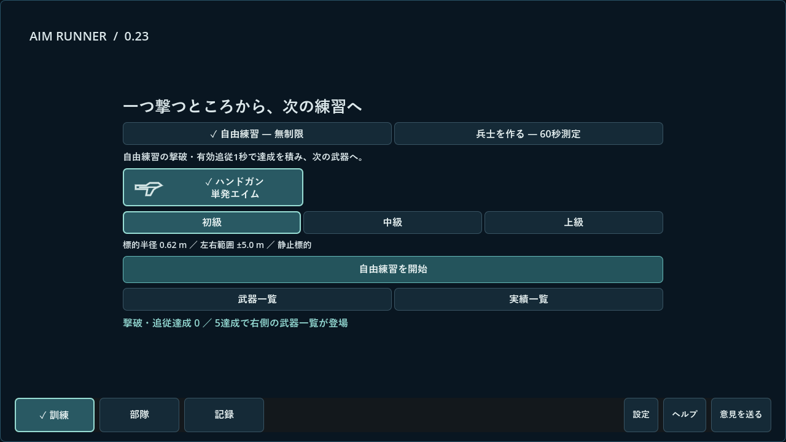
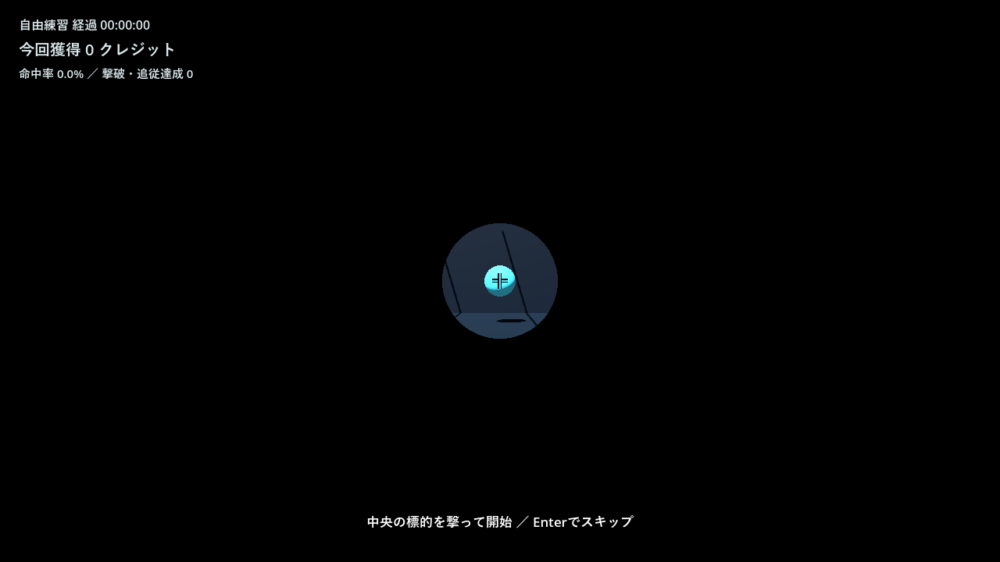
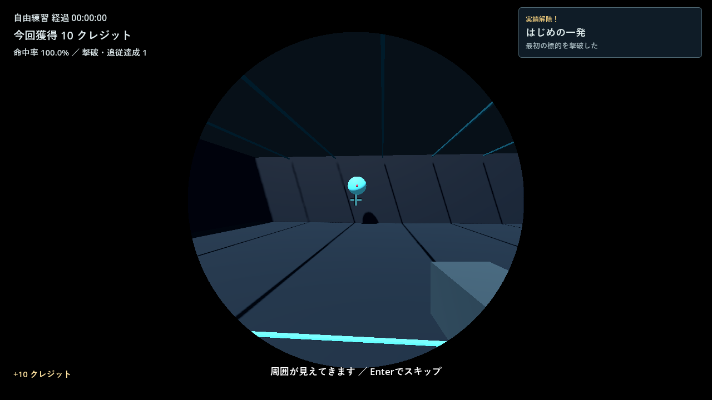
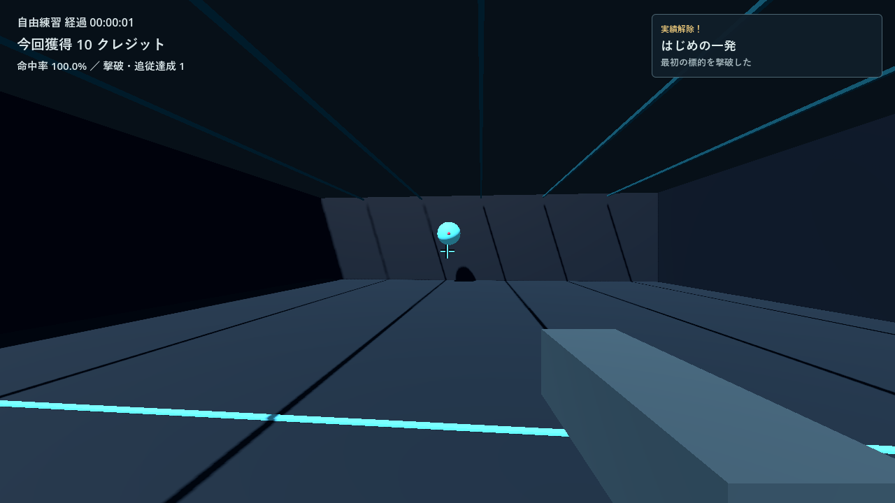
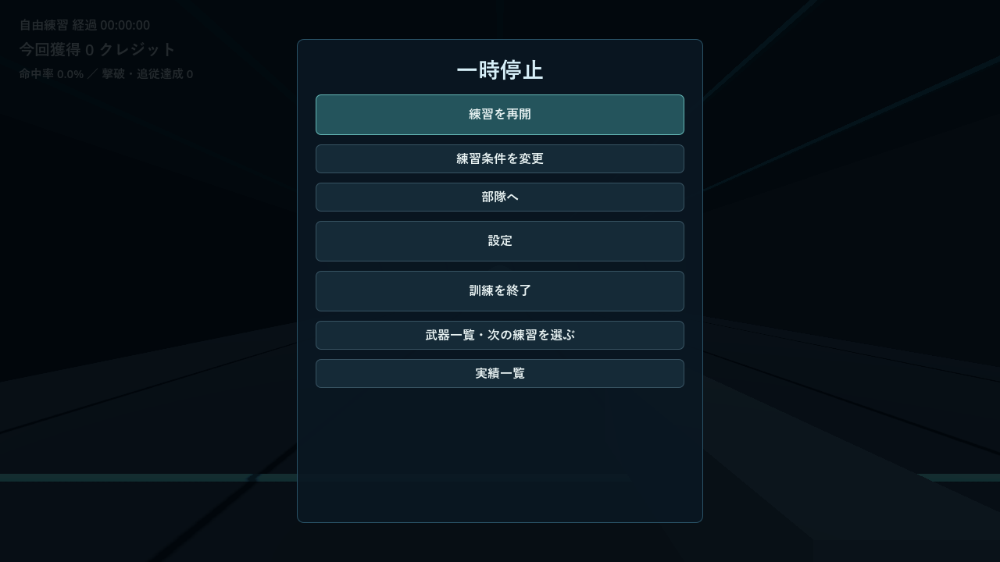
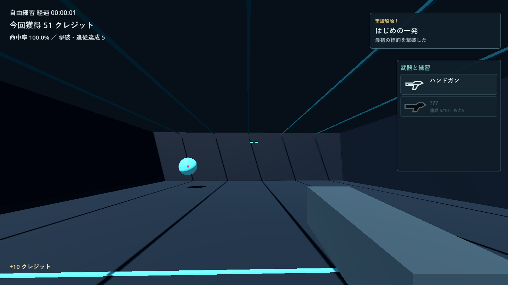
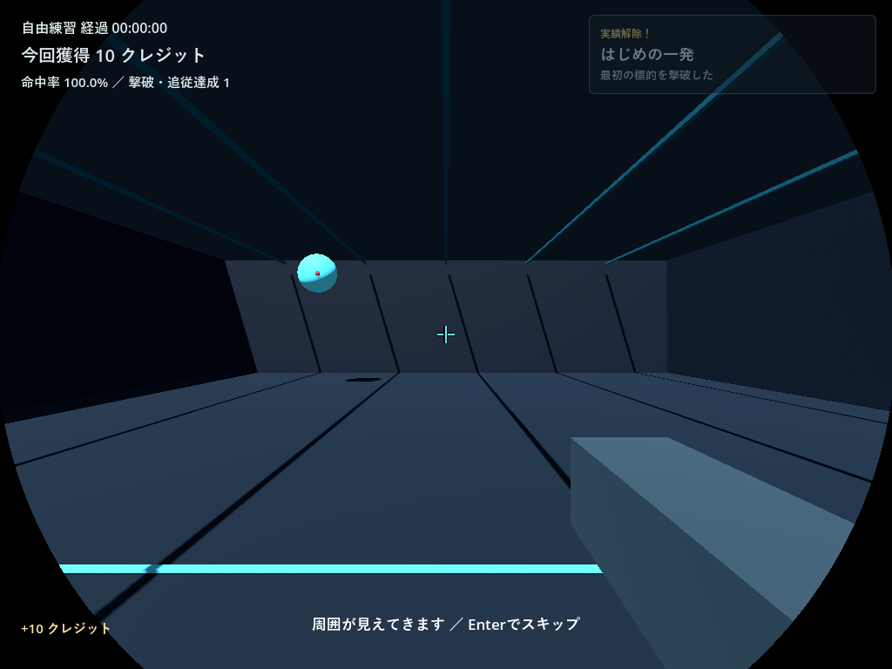

# Aim Runner 0.23 検証・配布報告

2026-11-07。開始時にGitHubの最新正式公開版が0.22であることと、作業ツリーに未反映変更がないことを確認した。ユーザー指定のWindowsで作業し、0.23として配布する。[確定範囲](023-scope.md)、[停止原因・前後計測と生データ](023-performance.md)、[演出部品](023-visuals.md)。

## 原因と実装

0.22では実撃破から全体同期保存へ進み、実績・一覧の既読確定でも全体保存を重ねていた。状態はTRAINING、paused=false、time_scale=1を維持しており、測定条件では一時停止への誤遷移は確認しなかった。有効測定履歴100件＋プロフィール6件（約40.8MB）の隔離fixtureでは、命中イベントと直後processのCPU時間は37,783.457msから2.586msへ変化した。これはheadlessの代表一回であり、GPUの平均・p95や人の入力遅延ではない。

進行と通知はメモリ上で即時反映し、保存要求を集約。射撃中に変化しない履歴・採用記録は開始前に専有cacheへ複製し、変更可能な枝だけをsnapshotへ渡す。workerはシーンやライブDictionaryを扱わず、完了snapshotをメモリへ代入しない。同期操作と終了はworker完了後に直列化し、従来の一時ファイル・再読検証・バックアップ・原子的確定を維持する。巨大データの開始前準備、一時停止・終了時の未完了保存待ちは残る。

武器／実績UIは固定構造を再利用し、非表示一覧の毎命中再生成を避けた。射撃・命中音6波形と新しい出現音は事前生成。円形アイリスは0.78秒、弱い演出設定で0.24秒、Enterでスキップ可能。実撃破一回を参照し、測定には入れず、既存セーブには初回を再表示しない。未解放は???・黒いシルエットで表示し、準備・簡易条件・測定・詳細・ヘルプの漏れを防いだ。数値の解放条件・採点・価格の調整はない。

## 実行した検証

- 現行10テスト一式が通過。進行境界、保存故障、更新、固定UI、既存中核78件・統合290件・境界26件、旧版と同じ標的配置・射線での採点と端数の一致、既存独立レビュー30件を含む。旧テスト一式をコピーせず、現行ファイルへ必要例を追加した。
- 最終配布PCKをGodot 4.7.2／Windows／RTX4060／OpenGL Compatibilityで実描画し、統合505件が通過。1280×720、1920×1080、1024×768の初回待機・円形開口・完了、照準、一覧、設定、UI境界を確認した。画像で見つけた準備画面アイコンの位置ずれと、長い武器名との重なりを修正して再確認した。先に無射撃で測定を中断しても最初の自由練習の案内を消費せず、有効測定や案内完了後は再表示しない境界も追加した。
- 実GUIイベントを武器選択ボタンへ送るテストで、射撃中の入力透過が停止メニューへ残らずクリックできることを確認。初回の静止標的を実射線で一度撃破、進行・実績一度、開口中心固定、フォーカス通知による停止、スキップ・途中終了・測定除外を確認した。音源事前生成、同フレーム出現音集約、無音、固定UIのノード再利用も検査した。
- 同フレームの連続保存要求、保存中の次撃破、古いsnapshotでの巻き戻り防止、失敗後の最新成果による再試行、一時停止での未保存成果確定を確認。
- 最終PCKの本番保存経路で、初回実撃破→開口完了→終了と、従来三測定の採用・新二種目を保存。別プロセス再起動で履歴6件、各測定回数1、採用3件、50クレジット、intro_seen・進行・着弾を復元した。解放用fixtureと自動入力・自動時計を使い、人が60秒を操作した試遊とは区別する。
- 旧実セーブの別名コピーと今回開始時の最新バックアップを隔離先へ読み込み、クレジット・設定・履歴・プロフィール・防具・防護・解放状態、元コピーのハッシュ不変を確認した。実セーブは読み取り・保全用コピーだけで、テスト状態を注入していない。
- Sol 6.1の独立レビュー・隔離probeは31件通過。snapshot/cacheの独立性、最新revision再試行、同期保存失敗の警告保持、初回の一度性と測定除外、保存中の終了ハンドラを確認した。終了はNodeへのWM_CLOSE_REQUEST通知であり、OSの閉じるボタン操作ではない。指摘された名前漏れと固定ボタンのmouse_filter復元も修正確認した。

## 配布EXEと未確認事項

Windows EXE/PCKのリリース書き出しは成功。通常EXEも隔離APPDATAで起動し、新規save_v2.jsonと直前保存の生成を確認した。ただしEXEへ外部検証スクリプトを渡した試行は成功マーカーを返さず、通常の新規保存のみ生成して待機したため、EXEによる統合・再起動検査の成功とは扱わない。自分の検証プロセスはタイムアウト時に終了した。

通常EXEの画面操作は、Computer Useと別の提供APIがともに初期化時に`failed to write kernel assets: 指定されたパスが見つかりません。 (os error 3)`で失敗し、クリック・OSフォーカス移動・閉じる操作を確認できなかった。PCKの実描画・GUIイベント・本番保存経路の検査と、通常EXEのOS操作を混同しない。

人の長時間試遊、実音声の聞こえ方・疲れにくさ、高DPI・別PC・複数モニター・実電源断・自動更新の実差し替え全工程は未確認。即時quitする独立検証ではAudioStreamWAV/Playbackの解放警告が出る回があり、通常の製品メモリ増加の再現とは未判定。workerのWeakRef解放は確認し、最終GPU統合ではこの警告は出なかった。

## Windows ZIP

EXE/PCK、日本語README・変更履歴・検証範囲とGodotライセンスの6ファイルを同階層に収録。実セーブ・認証情報・画像・テストは含めない。ZIP全メンバーを読み戻し、EXE/PCKが元ビルドのハッシュと一致した。サイズ38,367,092バイト、SHA-256 `60a610d98d5cb8055acfa696071a1fb83e84f29cb979b40a69130794a68ded3f`。更新機能のアーカイブ検証も通過した。公開後の確認は追記する。

## 担当モデル

保存・停止原因・統合はSol 6.1、アイリス・出現音・シルエットの限定補助はLuna 6.0、独立レビューと31件のprobeは別のSol 6.1。公開・配布作業と配布PCKの確認は主担当で実施した。Astraは使用していない。

## 実画像

隔離状態、最終配布PCKからの描画。解放後は明示したfixtureを使用した。

