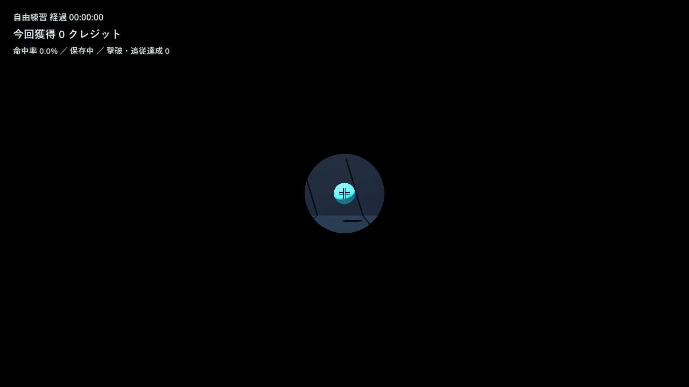
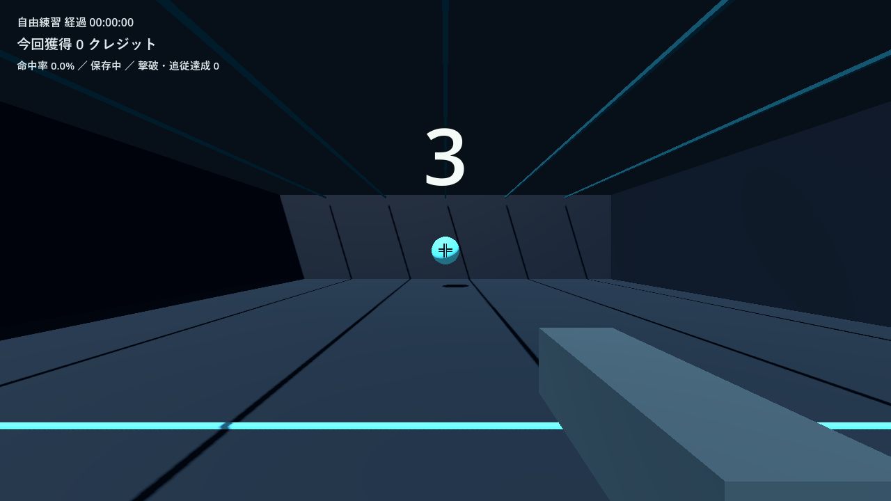
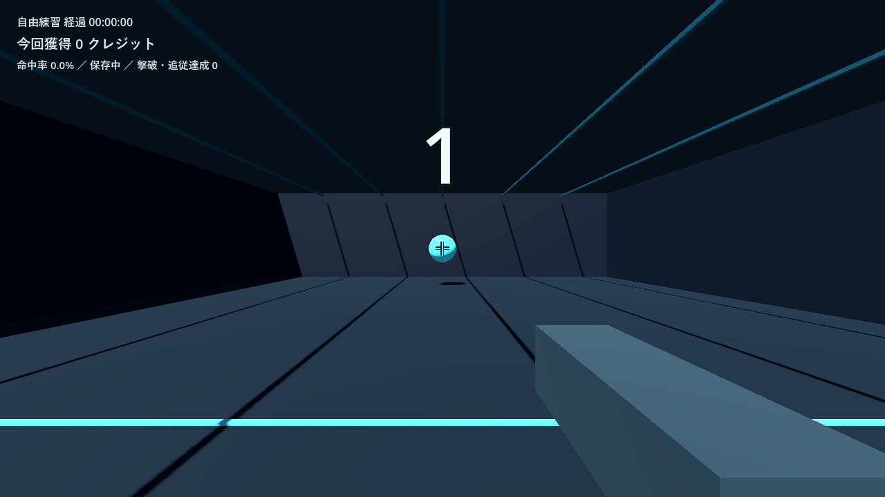
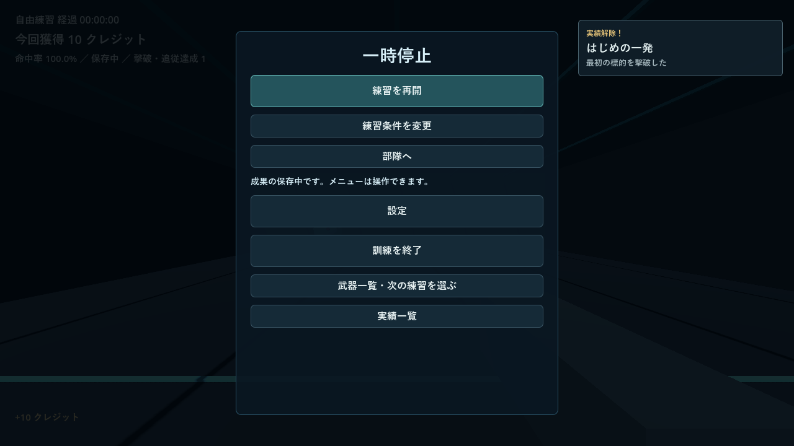
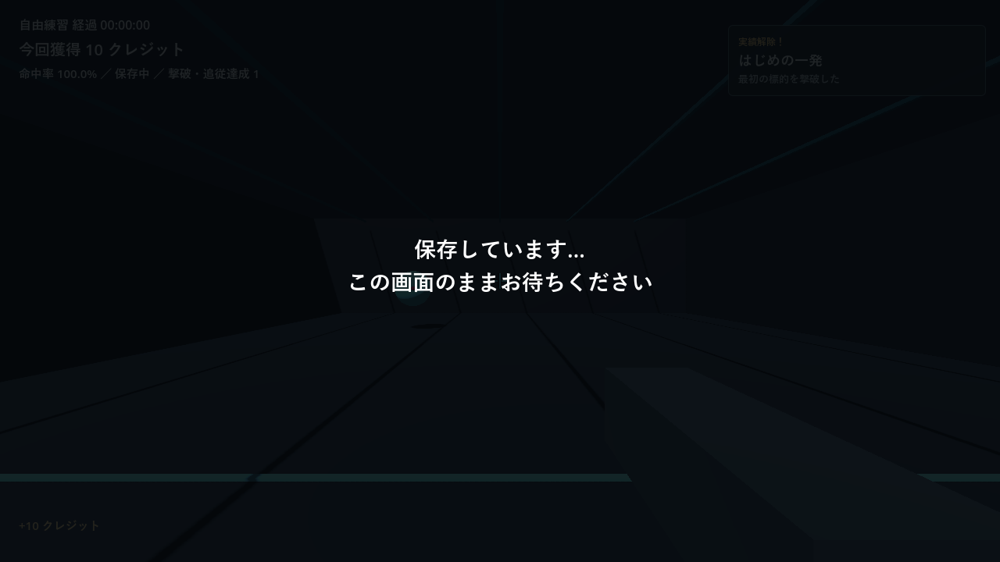
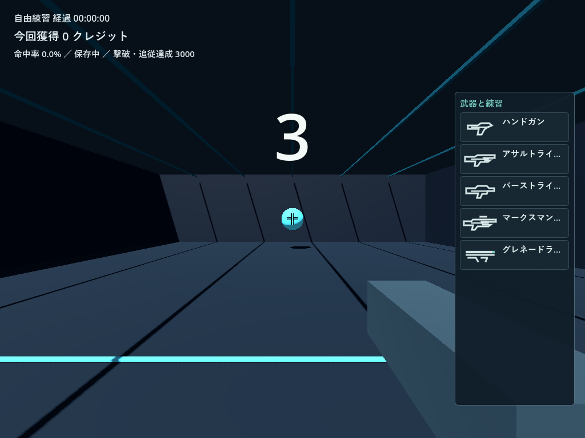

# Aim Runner 0.24 検証・配布報告

2026-11-07。着手時の最新正式公開版は0.23、未反映変更なし、0.24タグ未使用を確認した。ユーザー指定のWindowsで実装・検証した。[確定範囲](024-scope.md)、[Escの前後計測](024-performance.md)、[表示部品](024-visuals.md)。

## 確認した原因と修正

0.23の`next_game.gd::_open_pause()`は一時停止へ切り替えた後、`_save_current()`からworker完了待ちと全体同期保存へ進んでいた。メニューのvisibleがtrueでも、ハンドラーが戻るまで描画できなかった。有効測定100件・プロフィール6件の隔離fixtureで、Escハンドラーは保存待ちなし15,418.138ms、保存中32,047.665msだった。

0.24は停止状態・入力解除・メニューを先に反映し、通常の一時停止ではメモリ台帳と非同期保存要求だけを行う。同条件のハンドラーは0.505ms／0.388ms。これらはheadlessで各条件一回のCPU計測で、OS入力遅延やGPU描画時間と同一視しない。内訳・状態・生データは[計測報告](024-performance.md)に記録した。

保存は単一writer、worker専有の小snapshotとprivate archive cacheを使用する。通常Esc・再開で全履歴を複製しない。確定操作は旧cacheへの参照planと新規・差替recordだけを渡し、ライブDictionaryを共有しない。成功後だけ購入・採用・条件などを反映し、一時ファイル・再読検証・直前セーブ・原子的確定を保持した。終了時に同内容を二重保存する経路も除いた。大データの初期cache約0.9秒とworker保存約16秒は残る。

通常起動は前回の選択によらずHG自由練習・無制限。準備画面を描画せず、静止標的→自動アイリス→大きな3・2・1→射撃・計時へ進める。クリック待ちを置換し、描画待ちと一つの進行時計で二重減算を防ぐ。起動HGと解放状態を分離し、0／10／100／500／1,500条件と5達成の一覧、既存解放・設定・記録・プロフィールを保持する。採点・価格の調整はない。

## 配布PCKと実時計のGPU確認

- Godot 4.7.2／Windows／RTX4060／OpenGL Compatibilityで最終PCKの既存統合599項目が通過。720p、1080p、1024×768の数字・標的・照準・投影位置、入力、保存失敗・再試行、未確定購入、部隊・設定・条件変更、移行／復旧／失敗説明などを確認した。
- 既存`update_display_tests.gd -- --boot-flow`へ通常`is_test_mode=false`の起動検査を追加。手動時計を使わず、全描画フレームで準備非露出、iris→3→2→1→training、出現音1回、演出中の時間・発射・成果0、視点・標的・FOV不変を確認した。各数字は約0.98〜1.15秒で、PNG保存などの計測負荷を含む。[実時計ログ](024-boot-timings.json)。OSフォーカスを制御するためこの検査ではfocus_exitedだけを切り離した。
- 最終PCKの本番保存経路で履歴6件、三武器の測定各1・採用3件、50クレジットと進行を保存し、別プロセス再起動で復元した。旧実セーブの今回の別名バックアップを隔離先で読み込み、設定・記録・プロフィール・防具・解放・所持量と元コピーのハッシュ保持を確認。実セーブへテスト状態を注入していない。
- 現行10スクリプト一式、既存中核78、統合290、境界26、旧版と同じ射線・事実での採点一致、既存レビュー30が通過。別Sol 6.1の独立42項目ではsnapshot/cacheの独立性、失敗後の再試行、profile入替え、描画待ち、入力解除・測定除外を確認。旧テスト一式はコピーせず、現行へ必要例を追加した。

## 画面操作ツールを使わない配布EXE検証

外部画面操作は使用せず、配布EXEの同一バイナリを隔離検証フォルダーへコピーし、隣接する検証用PCKから未変更の製品PCKをmountする小さな起動ラッパーを使用した。製品の90資源・42個のGDScript bytecodeを全てSHA-256で照合し、ゲームは`is_test_mode=false`の本番保存経路を通す。製品EXE/PCKや製品コードへテスト機能を追加していない。入力は`Input.parse_input_event`でGodotのイベント配送を通し、描画は実GPUの`frame_post_draw`とviewport画像で確認した。OSの物理マウス・キー操作とは区別する。

今回使用したrelease templateは外部スクリプト指定の試行で通常起動になった。Godotの[公式CLI資料](https://docs.godotengine.org/en/latest/tutorials/editor/command_line_tutorial.html)でも、`--script`などのpath overrideはビルド条件付きとされている。ラッパー方式はこのCLI指定へ依存しない。起動sceneだけが検証ラッパーである点を明記し、EXEと製品資源の同一性は[照合済み結果](024-release-exe.json)に記録した。

| 配布EXEの条件 | Esc投入→メニューを含む描画 | 一時停止中200msの描画数 | 終了保存待ち／描画数 |
| --- | ---: | ---: | ---: |
| 新規 | 33.146ms | 8 | 109ms／5フレーム |
| 有効測定100件＋profile6件、writer処理中 | 33.113ms | 9 | 21,973ms／1,245フレーム |

各条件一回の実行例で、平均・p95ではない。重い終了保存も処理中画面を描画し続けた。両条件で自動開口・321・HG開始、ゲーム内クリック1回→発射1・撃破1・達成1、Escと再開、本番終了保存を確認。別プロセス再起動で10クレジット・達成1・射撃記録1を保持した。重い条件は既存100記録と6プロフィールも保持し、終了後は履歴101件だった。

EXE SHA-256：`acbbc00a8ec03a216a5821aa4185bb017cbed86d1199583b1eda7cda2dc04a19`。製品PCK：`3e8b7446b58325e05c5fc40aaf3a6096f68bf8cbea9603515ff11b2c90327a0b`。検証用ラッパー・fixture・実セーブは配布ZIPへ含めない。

## Windows ZIP

EXE/PCK、日本語README・CHANGELOG・検証範囲、Godotライセンスの6ファイルを同階層に収録。QAラッパー・テスト・画像・実セーブ・認証情報は含めない。全メンバーを読み戻し、EXE/PCKが検証済みファイルと同じハッシュであることを確認した。38,378,736バイト、SHA-256 `9dd145363b535bd97ce237bed602e686d05dc504d9edb5f46688ba315da4e5a7`。公開後の確認は追記する。

## 未確認事項・担当

OSからの物理マウス・キーボード配送、実際のOSフォーカス切替、人の長時間試遊、実音声の聞こえ方、高DPI・別PC・実電源断・自動更新の実差し替え全工程は未確認。内部のフォーカス通知・終了通知は自動検証しているが、OS操作の成功とは扱わない。大データの初期読み込み・cache作成と、確定操作の保存待ちは残る。処理中画面は操作可能な通常pauseとは区別し、確定中の競合操作を抑止する。

保存・起動・入力・統合と配布EXE検証補助はSol 6.1、表示限定はLuna 6.0、独立レビューは別Sol 6.1。主担当で配布PCK・実画像・成果物の照合と公開を行う。Astraは使用していない。

## 実画像

隔離した最終PCKまたは上記同一EXEによる自動検証の描画。

