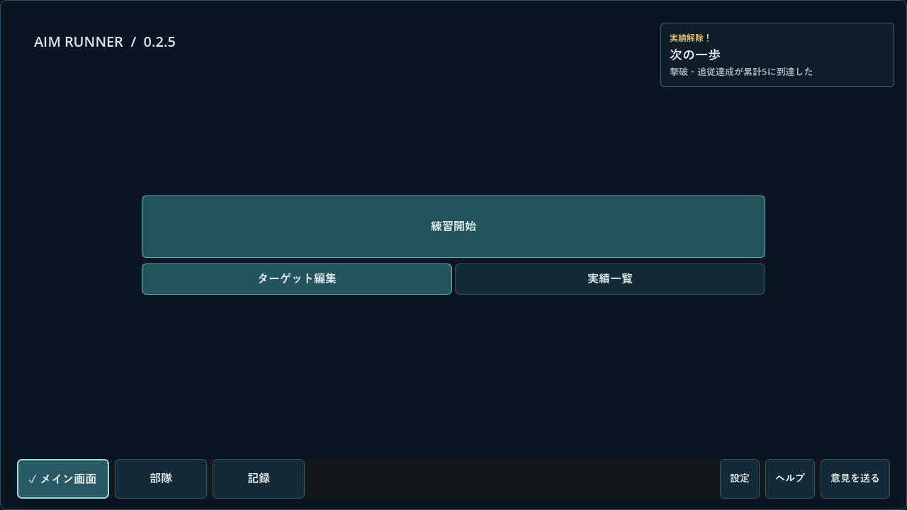
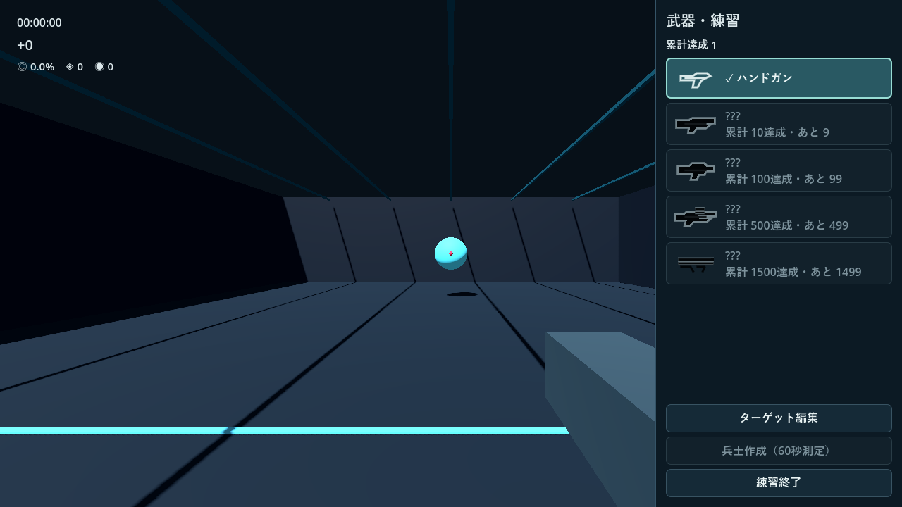
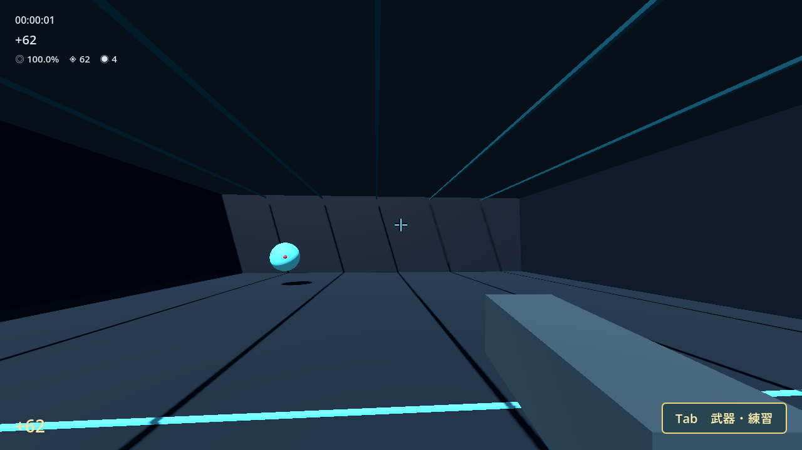
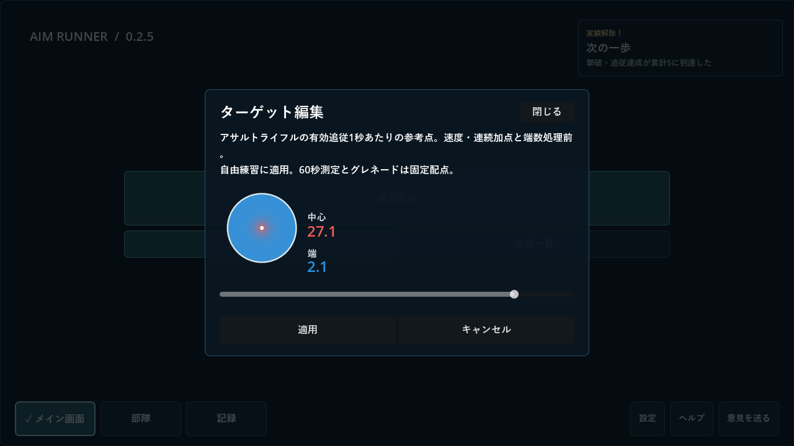

# Aim Runner 0.2.5 検証記録

2026-11-08。Windowsで作業した。着手時の作業ツリーはクリーンで、GitHubの最新正式版はv0.25。v0.24・v0.25の公開タグを照合し、v0.2.5が未使用であることを確認した。

## 操作と保存

- 通常起動はハンドガンの無制限自由練習。新規、全初期化後、アサルトと測定を選択済みの旧データで確認した。起動用の選択は保存済みの武器解放・選択値と分離した。アプリ内の武器切り替え後、メイン画面へ戻っても選択を維持する。
- 指の輪郭の先端をカメラから投影した静止標的の中心に合わせた。外れ、命中、アイリスの開口、3・2・1、出現音の一回再生を確認した。時計と通常成績はカウントダウン完了後に動く。Enterで誘導を飛ばせる。初回誘導の進行は一度だけで、再起動後は重複しない。
- Tabを押すと右端から五行がスライドし、離すと閉じる。武器を変えなければ同じ記録を継続し、変えたときは一度精算して別記録を開始する。5達成では実績だけを付与する。条件10・100・500・1,500と、未解放の選択拒否を確認した。
- 通常練習の有効命中3回でTabキーを強調する。誘導・外れ・測定を数えず、最初に一覧を正常に開いた時に既読を保存する。3命中前に開いた場合、Esc中の無効なTab、無視して次の練習へ進んだ場合、再起動、全初期化を確認した。
- 日本語のボタンでメイン画面・部隊・記録・設定・再開・終了・編集・検証用操作を識別できるようにした。ターゲット編集はメイン画面とTabで共通。メイン画面で適用しても練習記録は発生しない。練習途中では変更前後を別記録にする。編集画面は適用・キャンセル・閉じるで戻り、Tab解放だけでは配点を保存しない。

## 描画と配点

Windows・Godot 4.7.2・RTX 4060・OpenGL Compatibilityで、配布PCKを1280×720、1920×1080、1024×768で描画。指の座標、開口と321、五行と各ボタンの表示範囲を自動確認した。[起動時刻ログ](025-semver-boot.json)

0.24の公開タグの標的生成・材質を現行コードと比較し、射撃場の配点シェーダーと中心マークの材質上書きを外した。0.24と0.2.5の配布PCKを同一カメラ・同一標的位置で描画した結果、ハンドガン標的を含む96×96ピクセルのPNGはバイト単位で一致した。球体の材質は `#58edff`、中心マークは `#ff395c`。

採点は0.25の配点版5と曲線を使用する。プレビューの色は武器ごとの最大参考点を共通尺度にし、スライダー位置ごとに正規化し直さない。表示値は命中1発、アサルトでは有効追従1秒あたりの参考点で、速度・連続加点と端数処理前。60秒測定とグレネードは従来の固定配点。過去記録は保存済みの値を使用する。

## 自動テスト・配布版

- 現行10スクリプトを実行。進行・版番号・更新・一覧コンポーネント、保存中核87、v2統合269、状態境界44、採点5,059、射撃・再現等のレビュー30、統合394を確認した。一部ヘッドレス試験で終了時のObjectDB残存警告が出た。
- Sol 6.1の独立検証38項目がWindows実描画で成功。実際の命中イベント、Tabの3命中と既読、Esc・フォーカス、初期化、メイン編集と記録分離、保存の確定失敗を注入した後の再試行を確認した。主担当の機能作業と、指・ラベル・一覧のLuna 6.0担当を分けた。Astraは使用していない。
- 配布と同じWindows EXEを隔離フォルダーで起動し、検証用起動PCKから未変更の製品PCKを読み込んだ。製品資源98件・GDScript bytecode 46件を照合し、本番保存経路で起動、3命中、Tabでアサルトへ切り替え、配点適用、終了と別プロセス再起動、初期化と再起動を確認。187クレジット、履歴3件、編集値、Tab既読を復元し、初期化後は新規状態を確認した。試験資源とセーブは配布対象外。[EXE・PCKハッシュと結果](025-semver-exe.json)
- 保存の別プロセス試験で三武器の測定各1件、採用プロフィール、71クレジットを復元した。以前の実セーブは別名コピーを隔離先で読み込み、設定・所持量・プロフィール・防具・進行を保持し、原本コピーのハッシュも照合した。

## 版番号と更新

0.2.5から三要素の整数比較を採用する。0.2.5以降の0.2系と0.3〜0.20系を新体系に割り当て、既公開の二要素0.21〜0.25および旧1.x／2.xを区別する。0.2.10が0.2.9より新しいことと、新版が旧公開版へ戻らないことを確認した。旧0.25の実配布PCKでは0.2.5を新版として検出しない。**0.25からはゲームを終了し、0.2.5 ZIP全体を別フォルダーへ展開してEXEを起動する。** 従来の保存先を読み込む。

更新器のループバック試験で配布ZIP選定・取得・SHA-256・不正応答を確認した。Windows PowerShellの再起動補助は、隔離したテスト用EXEで更新成功と起動確認、起動失敗からのEXE／PCK復元、ハッシュ不一致での拒否を確認した。

Windows ZIPはEXE・PCK・README・変更履歴・検証範囲・Godotライセンスの6ファイル。全ファイルの読み戻しと更新器の受入を確認した。38,402,203バイト、SHA-256 `ec186d66a24e2c67811cf21862151a0e8ce64a54fe309c5e9bdd40b021c2411f`。

入力はGodot内の自動イベント、画面操作の呼び出し、フォーカス通知の注入で確認した。人による試遊、OSの物理キー配送、実際のOSフォーカス切り替え、実音声、高DPI・別PC・電源断は未確認。将来の正式な新体系リリースへの自動差し替え全工程は、テスト用EXEでの再起動補助確認と区別する。

## 実画像

[0.2.5フィードバック](https://github.com/cloford/supply-line-trainer/discussions/18)
