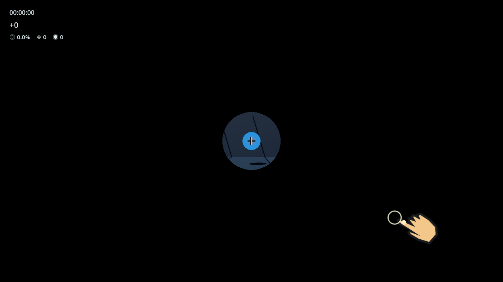
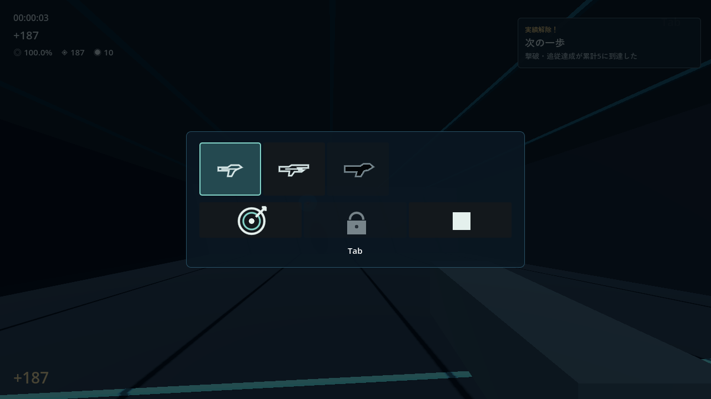
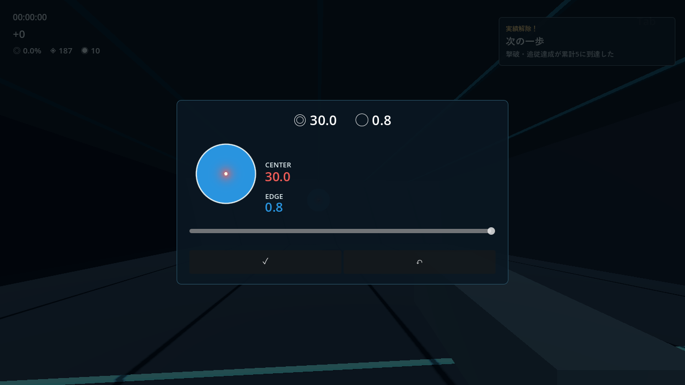
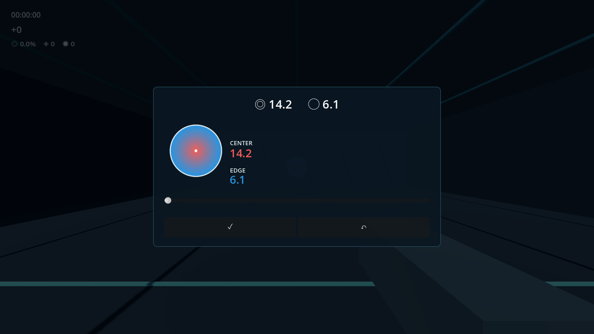
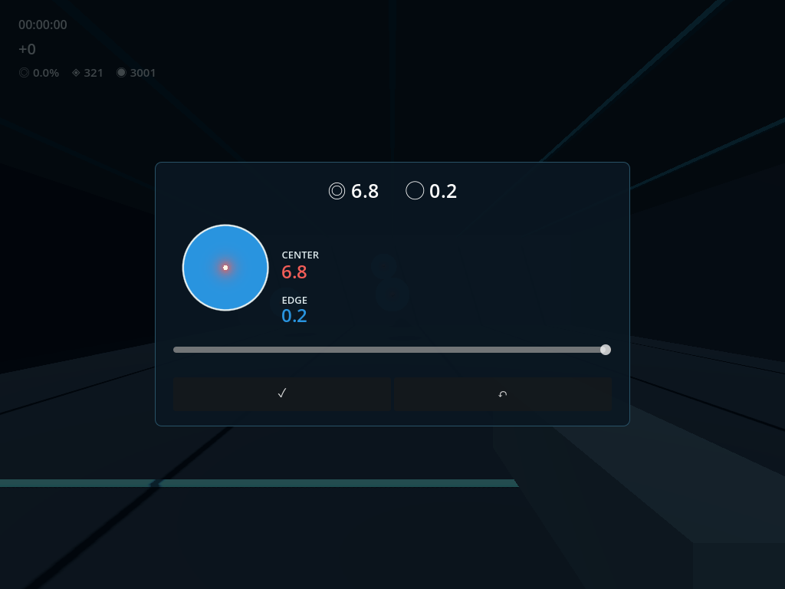
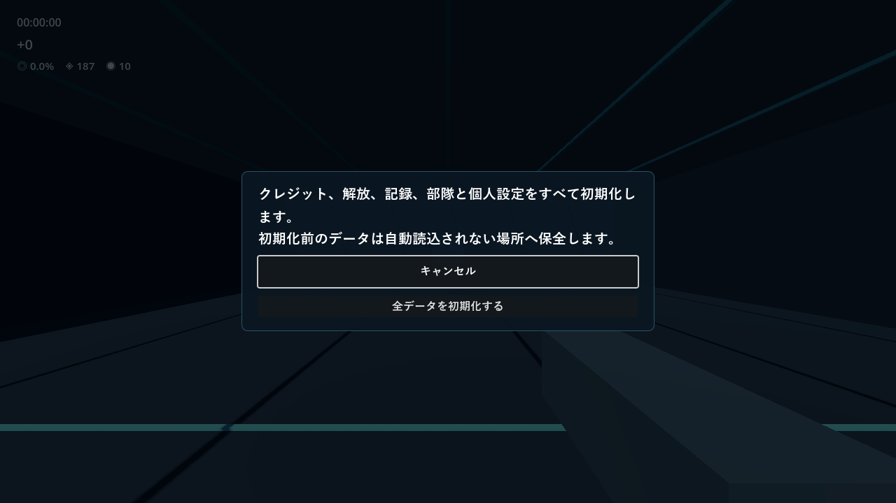
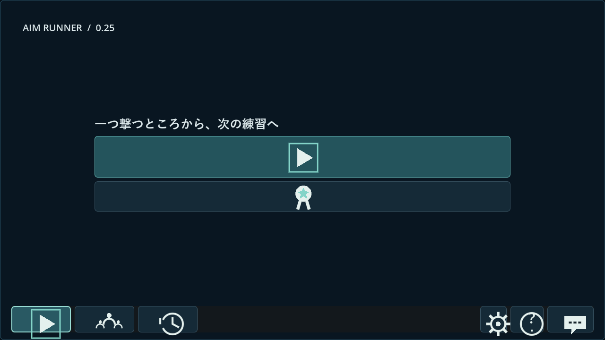

# Aim Runner 0.25 検証・配布報告

2026-11-07。着手時の最新正式公開版は0.24、作業ツリーに未反映変更なし、0.25未使用を確認。ユーザー指定のWindowsで作業した。[今回の確定範囲](025-scope.md)。

## 実装と保存保護

訓練の通常状態と、Tab・標的編集・検証操作・初期化の操作状態を分離した。Tab押下では先に時計・標的・射撃を止めてパネルを出し、開閉だけなら記録IDを維持する。武器や配点を確定変更すると旧記録を一度保存し、新IDへ移る。Tab内の変更には3秒の待ち直しを挟まない。60秒測定からの変更は中断記録となり、採用可能な完了測定にはしない。

初期化はキャンセルへ初期フォーカスを置く別の確認画面を使う。単一writerの進行中処理を描画しながら終え、初期化前データを`user://reset_archive_<日時・世代>/`へコピー・照合する。その後に新規状態を保存し、通常の直前セーブも新世代へ揃える。世代マーカーで旧バックアップやv1の再移行による復活を止める。成功後にworkerの専有cache・保存キュー・セッション・UIを新規状態へ切り替える。通常更新では進行を初期化しない。

初期化の保全先は`%APPDATA%/Godot/app_userdata/Supply Line Trainer/reset_archive_.../`。検証の実行先は隔離APPDATAであり、実ユーザーの初期化は行っていない。作業前の実セーブは別名で保全し、Gitや配布物には含めない。

起動は静止標的の小窓と入力を遮らない指を表示し、有効命中を待つ。外れでは開かない。命中後に約0.78秒（演出抑制時0.24秒）で開口し、描画待ちの後に3・2・1を各約1秒表示する。誘導は通常成績・測定へ混ぜず、生涯一回だけ達成へ反映する。既存の達成済みプレイヤーへ誘導の一発を再付与しない。最初はHG、以降は最後の解放済み武器を復元する。

## 初期調整値と採点

自由練習の新配点版は5、標的編集の初期位置は0.5。中心評価を持つHG・AR・BR・Gridへ適用する。グレネードと兵士測定は従来の固定式・版を使い、兵士の命中率・クリティカル率を変更しない。旧記録の残高は再精算しない。

中心への近さ`q`を0〜1、編集位置`r`を0〜1として、共有定義`TargetScoring.reward_factor`は`端倍率 + (中心倍率 - 端倍率) × q^(1.2 + 4.8r)`。プレビュー・数値・標的色・実採点が同じ定義を参照する。自由練習は基準難易度0へ揃え、旧記録の難易度は書き換えない。設定がない旧セーブは編集位置0.5へ補う。

| 編集位置 | 端の倍率 | 中心の倍率 | 標的面内の均一な命中分布の平均倍率 |
| --- | ---: | ---: | ---: |
| 左 0 | 1.30 | 3.00 | 1.782951 |
| 初期 0.5 | 1.00 | 4.20 | 1.248426 |
| 右 1 | 0.15 | 6.00 | 0.358865 |

平均欄は標的面の面積に対して均一な1,000点の数理比較で、人の射撃成績や成長速度の試遊結果ではない。中心へ集中すれば高報酬、広く当たる場合は右ほど平均が下がる。弾薬費や減点は追加しない。初期の4.2倍は、従来の基礎＋中心の最大2倍と速度・連続成功の上限を考慮して選んだ。速度・連続成功そのものは旧式の額・上限を維持し、同条件の中心合計は旧比約2.00〜2.10倍となる。編集値と配点版を各記録へ保存する。

加点表示は旧`hit_flash=0.9`から1.8秒へ延長した。表示が残っている間の短い連続加点は一つへまとめ、表示処理から付与しない。兵士作成の累計100達成は指定の初期値を維持し、既存の測定履歴・採用済みプロフィールがあれば利用権を維持する。

## 検証結果

現行テストを拡張し、旧版のテスト一式を複製していない。ソースでは採点5,059、保存中核87、状態境界40、既存v2統合265、現在の統合384、進行・版番号・更新器・一覧表示・レビューの各スクリプトが成功した。[別Sol 6.1の独立604項目](025-independent-review.md)も成功し、凍結前の中断履歴利用権の追加ケースは別に再実行した。

配布PCKでは実GPUの統合384項目、採点5,059、状態境界40が成功。別プロセスの保存→再起動では、三武器の測定回数`[1,1,1]`と71クレジット、記録・プロフィールを保持した。実セーブの別名コピーを隔離先で読み込み、所持量・設定・プロフィール・防具・進行と元コピーのハッシュが保たれることを確認した。実セーブへテスト値を注入していない。

Godot 4.7.2／Windows／RTX4060／OpenGL Compatibilityの実時計で、最終PCKの720p・1080p・1024×768を確認。誘導の外れと有効命中、開口・321、前回武器HG／AR／BR、出現音一回、演出中の成績・時間除外、全描画フレームで準備画面非露出、Tab・標的編集の操作領域と選択表示を検査した。[描画時刻ログ](025-boot-timings.json)には画像保存・初回シェーダー生成・並行実行の負荷も含み、一般的な起動性能のベンチマークではない。各数字はおおむね1秒、命中後の開口は約0.78秒だった。通常画面と設定は720p・1080pで描画し、武器・旧難易度欄が露出しないことも確認した。

実標的の色はカメラと標的のワールド座標から、採点と同じ射線距離で算出する。小さな標的の高配点部分が照準の縁取りに重なるため、色の切り分けでは一時的に照準と中心マーカーだけを隠し、標的そのものの中心が赤、外側が青になる画素を確認した。この非表示操作は検証用で、製品の照準を隠す変更ではない。

## 同じWindows EXEでの通し確認

外部画面操作ツールは使用せず、配布と同じEXEを隔離フォルダーで実行した。検証用起動PCKから未変更の製品PCKを読み込み、全製品資源と46個のGDScript bytecodeをSHA-256で照合する。ゲームは`is_test_mode=false`の本番保存を使う。製品へ検証用の入口やテスト用PCKは追加しない。Godot内部入力イベントで射撃・Esc・Tabを送り、UIの切替処理を呼び出す自動検証で、物理キーや人の試遊の代わりとは扱わない。[EXE・PCKのハッシュと実行結果](025-release-exe.json)。

- 新規起動の誘導命中で進行1、通常射撃9回で累計10。誘導は通常の発射・命中数に入らない。
- TabからARへ変更し、新しい記録IDへ移る。Tabを離すと3秒の待ち直しなく再開する。続いて標的編集を確定し、さらに別記録にする。
- 終了保存と別プロセス再起動でAR・編集位置1・累計10・187クレジット・分割した履歴3件を復元する。再起動の誘導から進行を再取得しない。
- 全データ初期化の確認と処理を実行し、別プロセスで再起動。クレジット・進行・履歴が空のHG新規状態であり、旧データが自動復元されない。

配布対象の資源一覧とZIPも照合する。検証画像・補助スクリプト・隔離セーブはエクスポートから除外し、実ユーザーのセーブ・認証情報も配布しない。

最終PCKは98資源／46 bytecode。EXE SHA-256は`1b29f5a53436a0345107df603ec58cfd0ee1d6d6b5adbf9b991b55c23640746b`、PCKは`64fb08186130629b4c78f41c82a2cbcb31d851f7f31738a2dda33ba3b677dee5`。同一EXEの4プロセスのログにはスクリプトエラー・エンジンエラー・警告はなかった。別の大量生成・破棄用の独立武器試験では終了時のGLテクスチャ解放診断、画面なしの境界試験ではObjectDB残存3件の警告が出た。試験終了処理の診断と通常配布EXEの結果を区別し、詳細は独立レビューへ記録した。

配布ZIPはEXE・PCK・日本語README・CHANGELOG・検証範囲・Godotライセンスの6ファイル。全ファイルを読み戻し、検証済みファイルと照合し、更新器のZIP検証も成功した。38,407,224バイト、SHA-256 `d2a998ec0c5998177a05d22b733085ae78f2f9db25d9163cb2feaa84bff1bfeb`。

2026-11-07に[PUBLICの正式版0.25](https://github.com/cloford/supply-line-trainer/releases/tag/v0.25)を公開した。製品タグは`9307b91`。公開後、最終PCKの`public_release_tests.gd`でAPI/CDNのリダイレクトからZIPを実ダウンロードし、サイズ・SHA-256・内容を照合した。`update_display_tests.gd -- --live`も成功し、「実行中0.25＝最新公開版0.25」、同版の適用ボタン無効を確認した。旧番号を与えた新版検査器の新版検出も確認したが、旧公開EXEの自動差し替えを実施した意味ではない。適用・更新再起動は行っていない。専用[Discussion #17](https://github.com/cloford/supply-line-trainer/discussions/17)を配布・変更履歴・検証結果付きの公開案内へ更新した。

## 実画像

## 未確認事項

OS物理入力の配送、実際のOSフォーカス切替、人間の長時間試遊、実音声の聞こえ方、高DPI、別PC、実電源断、自動更新の実差し替え全工程は未確認。外部の画面操作ツールへ依存せず、Godot内部入力イベントとUI処理の呼び出し、実GPU描画によって確認する。これらを人間の操作確認と同一視しない。

保存・採点・状態遷移はSol 6.1、表示部品はLuna 6.0、独立レビューは別Sol 6.1。Astraは使用していない。[0.25のフィードバック](https://github.com/cloford/supply-line-trainer/discussions/17)。
