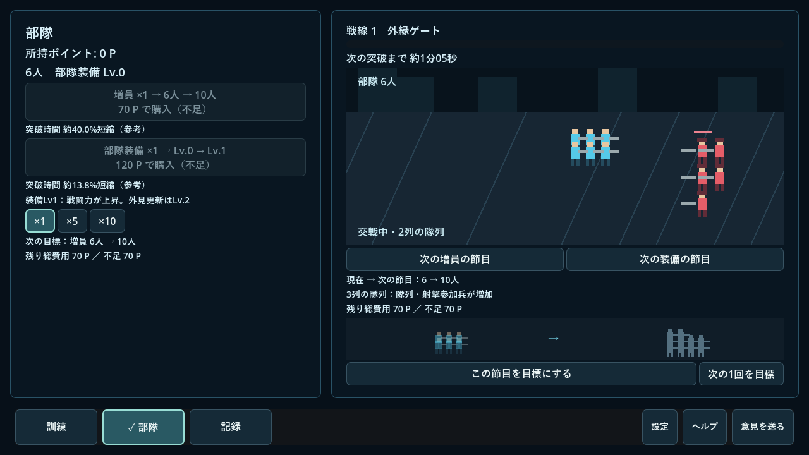
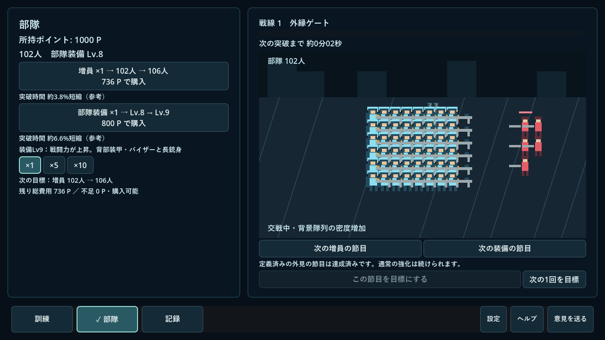
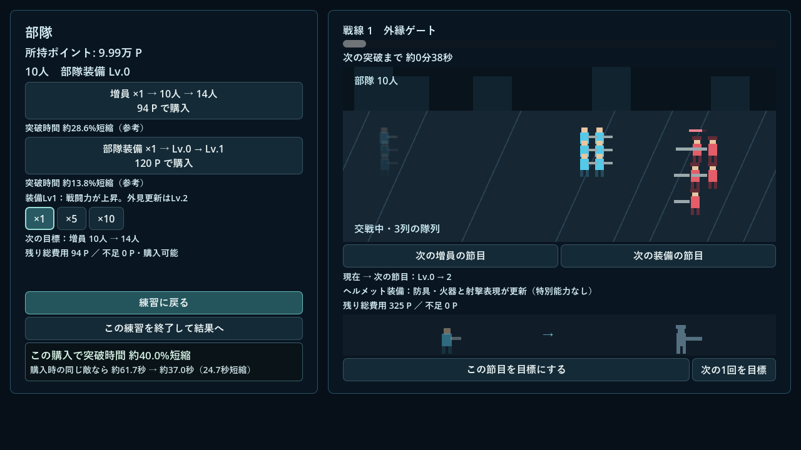
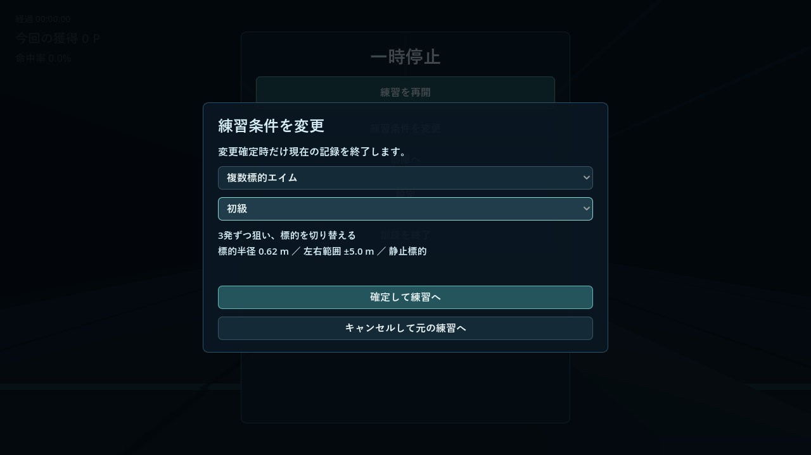

# v1.9.0 成長の節目と練習の往復

2026-10-23。v1.7へのプレイ感想に対する、v1.8からの追加改善。開始時の作業ツリーはクリーン、HEADと公開タグv1.8.0は`0e106a9`。正式リリースとWindows ZIPが公開済みで、未完了のv1.8公開作業はないことを確認した。第一段階のUIを巻き戻していない。

## 実装と保護範囲

- `GrowthGoal`で従来の1回購入目標と、新しい`mode: milestone`の節目目標を区別。種類・到達レベル・資金通知・達成通知を既存の目標辞書に保存する。旧目標を自動で遠くへ変更せず、節目は到達・別購入・再起動後も選択を保持する。到達で追加報酬はない。
- `total_cost`を購入と目標で共有し、各購入価格を切り上げた文字列整数の和を使う。単価×回数ではない。「残り総費用」は現在から節目までの購入総額、「不足」はそこから使える所持量を引いた値。訓練中は台帳未反映の差分だけを加える。
- `ArmyAppearance`の外見段階・隊列の列数・背景代表数を実表示と予告で共用。未来はシルエット、効果と条件は文章で明示。新素材や外部生成サービスは使っていない。
- 増員後は前景の広がり・列数・射撃参加と背景密度が残る。前景48・背景72・一時援軍12・射撃演出10の上限を維持。全体の自動縮小で成長を打ち消さない。装備Lv.8は背部装甲、バイザー、長銃身、二重の射撃線。通常の各装備購入で戦力が上がり、節目の特別能力・追加ダメージはない。
- 部隊の左に購入・選択目標、右に戦場・切り替え式の直近候補を配置。戦線ゲージは右の一つへ集約。時間短縮比較は小さな補足とし、成功通知は左下へ置き戦場を覆わない。
- 準備・結果は選択中のコンパクトなカードだけ。HUDの標準オフと既存設定を維持。訓練へ外見演出を割り込ませない。

## 節目を選んだ理由（価格は変更していない）

増員は1購入4人。初期6人から、早い段階で列が増え、その先で背景隊列へつながる値を選んだ。下表の費用は新規状態から当該種類だけを購入した合計。所要時間は既存の中程度の合成射撃約330P/分を丸めた基準で割った試算であり、人の試遊時間や到達保証ではない。他方の強化も買えば長くなる。

|対象|到達条件|通常表示の変化|新規から総費用|参考練習量|
|---|---:|---|---:|---:|
|増員|10人（Lv.1）|2列→3列|70P|約13秒|
|増員|18人（Lv.3）|4列へ展開|282P|約51秒|
|増員|30人（Lv.6）|6列と射撃参加の増加|780P|約2.4分|
|増員|50人（Lv.11）|前景上限と背景隊列の開始|2,135P|約6.5分|
|増員|102人（Lv.24）|背景密度の増加|9,114P|約27.6分|
|装備|Lv.2|ヘルメット・更新火器|325P|約1分|
|装備|Lv.5|防具・重火器|1,450P|約4.4分|
|装備|Lv.8|強化装甲・長銃身・射撃線|3,340P|約10.1分|

Lv.5→8だけなら1,890P、同じ仮定で約5.7分。既存Lv.0／2／5の先として遠すぎない一段を実装した。合成基準の条件と限界は[既存の報酬分析](reward-decision.md)を参照。未来の未実装装備や地域は並べない。

## 保存と再開の境界

主担当が`main.gd`と保存境界を管理し、今回はサブエージェントによる同時編集は行っていない。

一時停止から部隊へ入る前に、訓練の累積スナップショットを既存台帳へ差分適用した候補を保存する。成功時だけ候補を採用し部隊へ移動。失敗時は一時停止に留まり、理由を表示して再試行・再開ができる。

部隊滞在中は同じ3Dノードを残し、モードによって訓練側の更新だけを止める。時間、標的位相、反応・連続成功の時刻は訓練時間に従う。部隊は従来の一つの更新経路で戦闘を続け、一時停止・設定・フォーカス喪失では停止する。再開で育成データのスナップショットを復元しないため、購入や目標を巻き戻さない。

条件変更は共通カタログと既存難易度定義から選択。キャンセル・同条件は記録を閉じず再開する。変更確定時だけ既存の比較作成・台帳終了を候補へ適用し、保存成功後に新しいIDで開始する。失敗時は旧記録を保持する。往復だけでは履歴・練習回数を増やさず、比較へ自己記録を混ぜない。

成果・購入は既存のチェックポイントで復元。3D状態の再起動復元は追加していない。新たなリセット移行は不要で、既存の移行前バックアップ・読込失敗時の保存停止を保持。実セーブはローカルで別名バックアップ後、隔離コピーの読込・再保存・再読込を行い、原本のSHA-256不変を確認した。個人のセーブや履歴を公開リポジトリへ含めない。

## 実行した検証

- `continuity_tests.gd`：節目総額と実購入の一致、1P不足、資金通知一度だけ、×10で段階通過、別購入と再起動の目標保持、ロード時の達成済み扱い。
- 3武器の訓練→部隊→購入→同じ訓練へ直接復帰。時間・成績・視点・標的・位相・連続成功・反応時刻・追従集計の保持、残高・強化の保持、往復と終了での差分精算一度だけ。
- 3武器の同じ物理レイ入力を中断なし／部隊45秒滞在で再生し、得点・端数・生の射撃事実・q集計・標的位相が一致。最初はテストの初期端数が揃っていない比較を検出し、初期データを揃えて再実行した。
- 簡易条件変更のキャンセル・同条件・確定・連打、旧記録を一度だけ終了、新しいID、比較に自己を含まないこと。
- 保存用一時ファイルの位置にディレクトリを作り、差分保存・条件確定・購入の失敗を再現。未保存状態で部隊購入へ進まず、元のデータと記録を維持して再開できること。
- 部隊滞在中の保存をロードし、購入済み装備と残高を保った中断復元が一度だけになること。電源断や実際のOSクラッシュそのものではなく、保存済みチェックポイントの再読込による検証。
- `scoring_regression_tests.gd`：公開v1.8.0のmainをメモリに読み込み、同じ固定乱数・物理レイ入力を3武器に再生。得点・端数・stats・q合計／積分が一致。
- 既存のコア、練習台帳、指標、3武器、UI、成長、部隊、購入比較、報酬、保存互換、指標保存、更新、第一段階の保存・描画テストを実行。購入比較テストの待機が初回実行で不安定だったため、遅延登録の1フレームを待ち、不正時もハングせず検査できるようテストを修正した。
- `metrics_capture.gd`で実射線から結果・再挑戦・参考比較・意識項目・購入・記録・保存再読込を実描画で確認。
- 1280×720／1920×1080で初期6人・10／18／30／50／102人・大人数、Lv.0～8、購入成功・節目達成・一時停止・条件変更を描画。大きな残高、主要ボタン・パネルの範囲、代表数上限を検査し画像を確認。新しい検査はOSの偶発的なフォーカス・マウス入力を分離し、フォーカス喪失は明示的に再生した自動操作。

射撃・採点v4・指標v1・比較キー・価格・戦力・敵耐久・引継ぎ効果は変更していない。新しい通貨・自動収入・地域・練習・武器ロックはない。

## Windows配布版

Godot 4.7.2 stable、Windows、NVIDIA GeForce RTX 4060／OpenGL Compatibility。`SupplyLineTrainer-v1.9.0-windows`の最終PCKを`--main-pack`で読み、`continuity_tests`・`stage1_tests`・`metrics_capture`を再実行して成功した。これはコンパイル済みゲームを外部テストで操作した検証で、人の手動試遊とは異なる。

同じフォルダーのWindows EXEを実セーブの隔離コピーで通常起動し、120フレーム後に終了コード0・標準エラーなしを確認した。完成ZIPを別の一時フォルダーへ展開したEXEも起動・終了コード0。ZIPの構成は`package_test`で更新機能が受理することを確認した。ユーザーの原本は不変。旧版のタグやZIPは上書きせず、新しいZIP名・タグ・アプリ内版をv1.9.0に統一する。公開後のAPI・配布ファイルは`public_release_tests.gd`で更新検出・取得・digest・ZIP構成を確認する手順とし、インストールや再起動は自動実行しない。

## 未確認・人の試遊で確認してほしいこと

人による長時間の操作感・面白さ・成長への興味、別PC、高DPI・複数モニター、実際の電源断は未確認。自動テストだけで「欲しくなった」「続けたくなった」とは判断しない。

1. 次のシルエットと説明から、欲しい成長を自分で選べるか。
2. 増員や装備購入後、短い通知が消えても変化が分かるか。
3. Esc→部隊→購入→練習に戻る操作が短く、誤射や条件変更の誤解がないか。
4. 目標を追わず好きな練習を続ける場合にも邪魔にならないか。

## 画面例（隔離した確認用進行）

