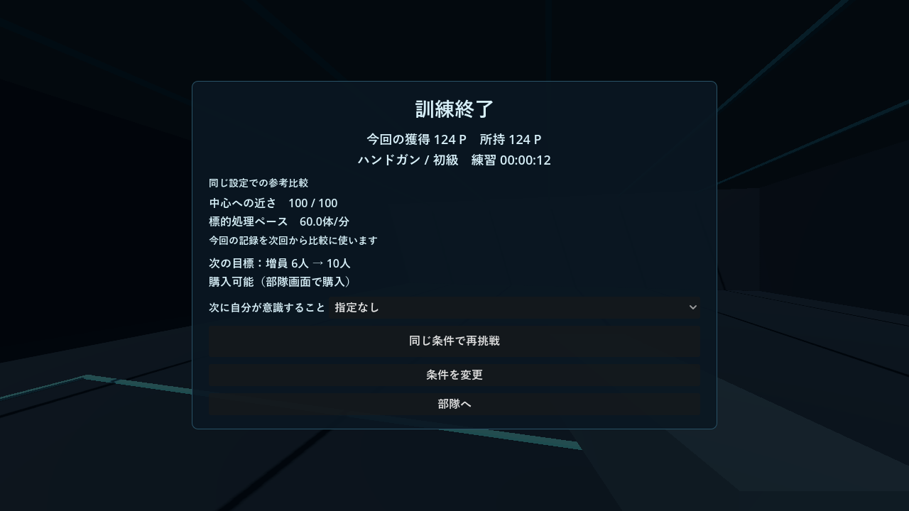
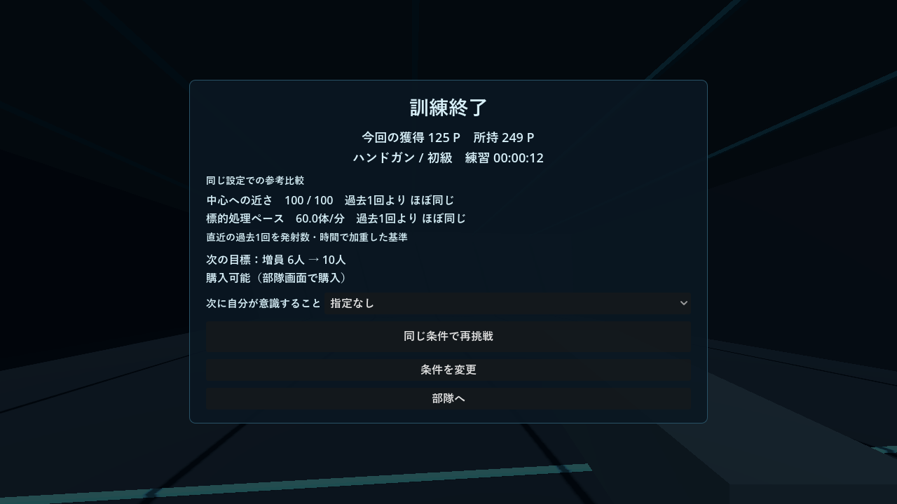
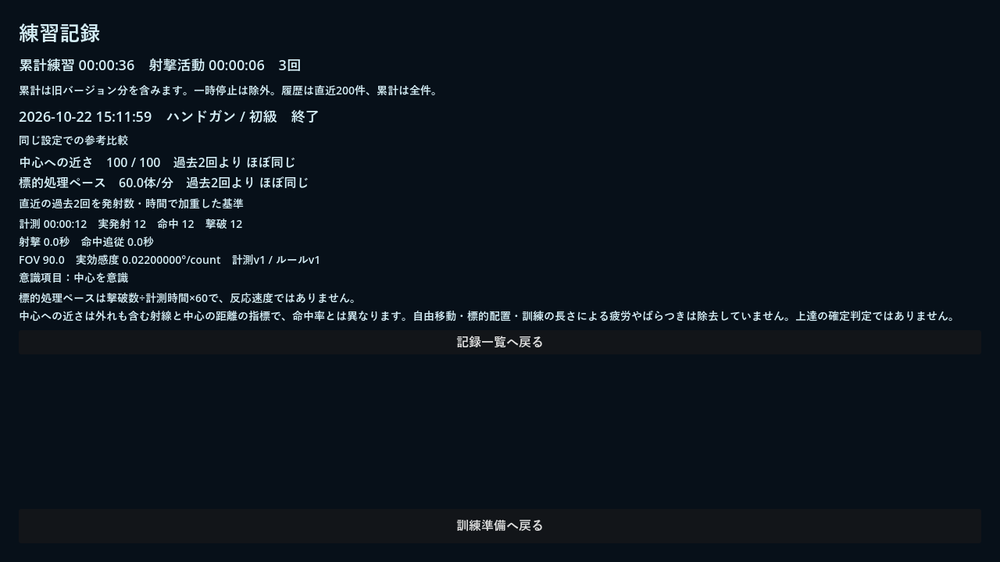

# v1.6.0 検証結果

実施日：2026-10-22。基準コミット `e9b3425`（v1.5.0）、開始時に未コミット変更・適用AGENTS.mdなしを確認しました。

## 自動テスト

- `metrics_tests.gd`：全中心・全外れ・混合、端・半径違い、分母0、10秒／10弾／3秒境界、過去0～4件、加重平均、現在追加済み・重複・未来・異武器／難度／FOV／実効感度／版、関連設定変更、中断復元、60/120Hzの時間積分、選択射撃と継続追従の違い、JSON再読込、比較基準snapshotの保持、台帳再実行を確認。
- `scoring_regression_tests.gd`：固定したv1.5.0コミットのmainをメモリへ読み込み、改修後と同じ実レイ入力を3武器へ再生。外れ・中心・撃破・連続を含むstatsとポイント辞書（端数含む）が完全一致。採点式・価格・部隊戦闘式の差分なしも確認。
- `metrics_save_tests.gd`：旧記録の保持、一度だけの原本バックアップ、再読込、書込失敗時の原本保持。別の隔離領域でバックアップ先をディレクトリにしてコピー失敗を再現し、保存禁止と元ファイル不変を確認。
- 既存 `tests`、`practice_tests`、`training_tests`、`ui_tests`、`battle_tests`、`growth_tests`、`save_compat_test` が成功。3武器の物理命中、二重精算防止、右長押し終了、Esc・フォーカス停止、購入・成長・音設定を回帰確認。
- `updater_tests.gd` も成功。ローカルHTTP取得・SHA-256一致／不一致、404、不正情報、プレリリース拒否、ZIP内容検証を回帰確認しました。

## 自動操作と実描画

`metrics_capture.gd` をNVIDIA GeForce RTX 4060 / OpenGLで実行。実射撃12発・12秒で初回結果→指定なし再挑戦→比較あり結果→意識選択と開始前表示→結果→部隊購入→一覧選択→詳細→保存再読込を操作しました。別の実レイ試験でバースト1発後の停止（予定2発は計測しない）と3発撃破（qを二重加算しない）、一時停止・フォーカス喪失の凍結、設定適用後に元へ戻しても比較対象外となることを確認。

1280×720／1920×1080のクライアント画像を保存し、結果と記録詳細の主要Control／ボタンの範囲検査を通過。初回・比較差0・指定なし・選択ありを確認しました。短い記録・無発射・長い数値の描画は隔離複製への状態注入で確認し、実際の人の射撃結果とは区別しています。加点内訳オンも見切れなしです。比較用の新しいスクロールバーは追加していません。

実レイ中心照準には3D姿勢計算の微小誤差があり、ランダム配置の異なる再挑戦同士の未丸め点は0.02P未満の許容差、再読込の浮動小数は相対1e-12／絶対1e-9で比較しています。旧版対新版の同一入力試験は完全一致です。

WindowsリリースEXEを生成し、NVIDIA/OpenGLでの起動（検証用初期データ）と、実セーブのコピーを読む通常起動を実行しました。ともに終了コード0・標準エラーなし。初回バックアップのハッシュも原本と一致しました。通常起動の短時間終了だけでは計測スキーマの保存はまだ発生しておらず、保存再読込の検証は前記の開発環境で行っています。配布版へ外部の検証スクリプトを渡す試験は完了しなかったため専用プロセスを停止し、配布版の体験経路全体を確認済みとはしていません。

## 実セーブの保護

ユーザー原本の別名コピー：`outputs/save_before_v1.6.0_20261022-150512.json`。

SHA-256：`977297117fae42978fe48fdaa4a07cc79243720886d9fc4277d986cf9d3e4430`。

専用APPDATAへのコピーで、283P、増員Lv.13、装備Lv.3、内部戦線18、設定・旧履歴・累計を保持して読込・保存・再読込できました。テスト後もユーザー原本と一度目のバックアップのハッシュが一致。実ユーザー領域は変更していません。

## 担当とレビュー

主担当：Sol 6.1（計測・保存・比較・射撃接続・UI統合・テスト・ビルド）。UI担当：Luna 6.0（`shooting_review.gd` と `practice_records.gd` の表示のみ）。UI完了後の独立レビュー：Sol 6.1（読み取り、指摘なし）。同時稼働は主担当込み2体まで、孫エージェントなし。レビューはソース確認で、独立した実機テストではありません。

## 未確認・人間の試遊が必要なこと

人間による射撃・楽しさ・理解しやすさ・別日の継続効果、別PC、今回の1024×768専用描画とWindows高倍率は未確認です。今回のAI自動操作を「上達が実感できた」「面白くなった」という根拠にはしません。更新の実配信から旧版へ自動適用する全経路は今回再実施せず、既存機能を維持します。

ユーザーテストでは「今回の撃ち方を読み取れたか」「次に試したいことが浮かぶか」「数字を義務や否定と受け取らないか」「比較を読まなくても快適か」「別日にも再挑戦の理由になるか」を確認してください。長時間化・再挑戦数・ポイント増加だけで改善を断定しません。

## 画面例（自動操作・テスト用データ）

