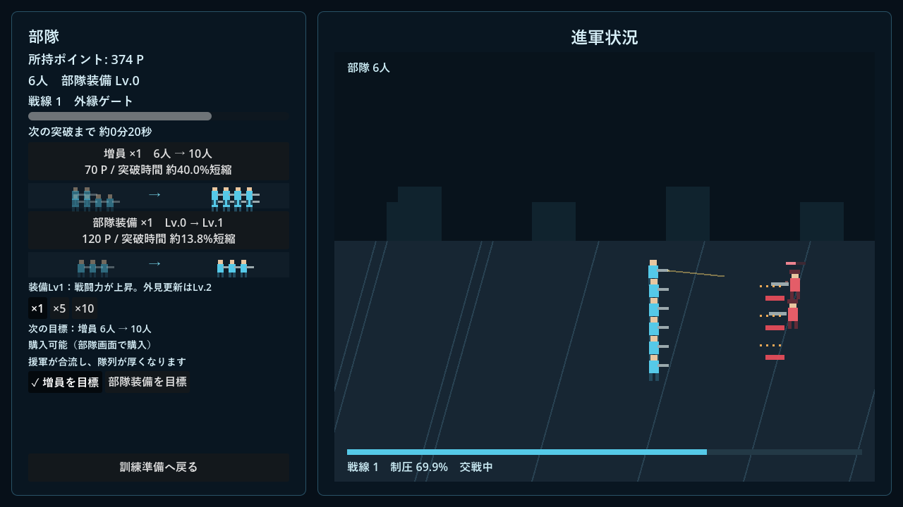
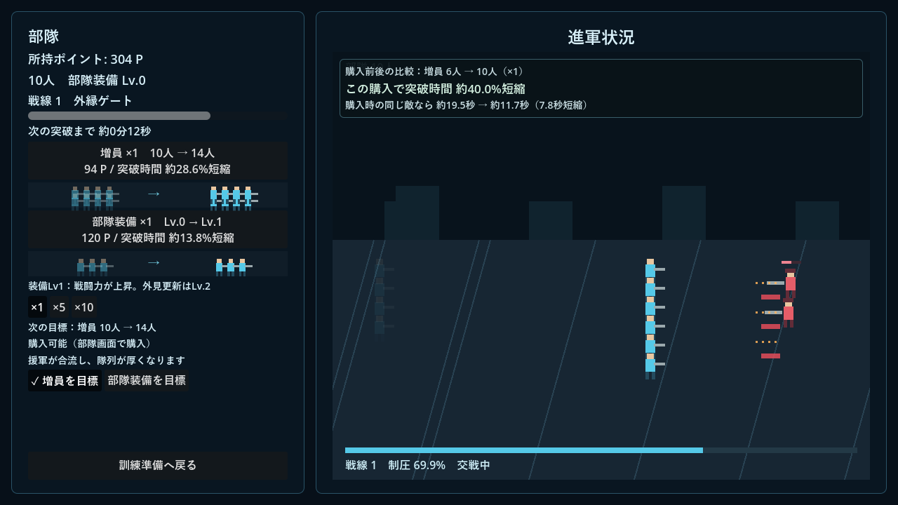

# v1.7.0 検証結果

基準v1.6.1（68686ac）。基準記録、改善案2、改善案3の分析・集計保存を別コミットに分離した。開始時の未コミット変更・適用AGENTS.mdなしを確認。

## 改善案2：実装・検証完了

`purchase_effect_tests`：既知H/DPSの時間・率、増員／装備×1/5/10、引継ぎ倍率、非有限・DPS0・残耐久0・負数・1秒未満、プレビューと取引後のDPS一致、保存成功後だけ通知、連打拒否、不足・保存失敗、最新購入への置換、期限切れ、画面再表示、戦線変更後の秒数非表示、表示の有無で進行不変を確認。

`scoring_regression_tests` は基準コミットのmainをメモリへ読み込み、同じ乱数と実物理レイを3武器へ再生。stats、得点・内訳・端数、q合計・積分が完全一致。改善案2だけの段階で先に通し、改善案3統合後も成功した。価格・部隊式・敵耐久・武器解放条件は変更していない。

## 改善案3：分析・検証手段まで完了、配点調整は見送り

`reward_analysis` で固定合成54条件と候補2種類を再評価。[比較表](reward-comparison.md)と[見送り理由・次の最小試験](reward-decision.md)を参照。人間の記録による候補効果の実証ではなく、配点は維持した。

`reward_tests`：現行＋候補2種類について中心精度の単調性、無操作／全外れ0点、非負・有限・内訳の和、同じ採点前総量の1/4/40分割と保存頻度1/7/15の変更、二重確定防止、大整数残高・端数を確認。製品の射撃処理へ固定レイ結果を再生し、バースト途中命中・撃破とq独立、オート60/120Hzの得点許容差0.02P未満・技能指標一致を確認。これは実物理レイ試験とは区別する。

## 保存と既存機能

`reward_save_tests`：旧履歴・当時の比較要約・旧pending・残高・端数を保持。旧記録にrawを推測追加せず、旧成果の再計算・再加算なし。新規スキーマ、一度だけのバックアップ、再読込、コピー失敗時の保存禁止と原本不変を確認した。バックアップ先をディレクトリにした失敗試験のコピーエラー出力は意図したもの。

既存 `tests`、`practice_tests`、`metrics_tests`、`training_tests`、`ui_tests`、`growth_tests`、`battle_tests`、`save_compat_test`、`metrics_save_tests`、`updater_tests` が成功。採点版4・計測版1・ルール版1を維持し、技能比較・右長押し・Esc・設定・音・購入目標・部隊進行・更新を回帰確認。更新試験の「実行中が新しい」固定値が今回の1.7.0と一致してしまうテスト側の問題を修正し、実行中より大きな版を生成して再試験した。

ユーザーの旧セーブはローカルだけで別名バックアップし、専用APPDATAへのコピーで各進行・設定・履歴・比較要約を保つ読込・保存・再読込を確認した。原本と一度目のバックアップの一致を検証。ユーザーの進行ファイルへ書き込むテストは行っていない。記録や集計を公開リポジトリへ送信していない。

## 開発環境と配布データの操作確認

`metrics_capture` をNVIDIA RTX 4060 / OpenGLで実行。実射撃・任意終了・同じ条件の再挑戦・意識選択・参考比較・部隊購入・購入比較・次の目標・記録詳細・保存再読込を操作した。1280×720／1920×1080で主要ボタンと通知の範囲検査を通過し、画面例を取得。長い値等のレイアウト境界画像は隔離データへの注入であり人の成績ではない。

一度OSの偶発的なフォーカス移動で自動操作が停止したため、通常経路の自動化だけOSのfocus_exited接続を切り離した。フォーカス停止自体は後段で製品の停止処理を明示再生し、別のUI回帰試験も通した。製品のフォーカス処理は変更していない。

WindowsリリースEXEは隔離初期データで起動し終了コード0、標準エラーなし。さらに同じ配布PCKをGodot 4.7.2の`--main-pack`で読み、外部検証スクリプトから上記体験経路全体を再実行して成功した。配布済みのコンパイル済みゲーム処理を使うが、単体EXEへ人が入力した試遊ではない。検証スクリプト・合成分析・セーブは配布PCKに含めない。

## 担当・独立レビュー

主担当Sol 6.1：計算・採点分析・保存・統合・検証・ビルド。UI担当Luna 6.0：計算済み表示データを受け取る`purchase_effect_view.gd`のみ。UI完了後にSol 6.1が読み取りレビューし、修正必須の欠陥なしと報告。同時稼働は主担当込み2体、孫エージェントなし。独立レビューはコード確認で、独立した実機再テストではない。

## 未確認

人間の好きな撃ち方・義務感・満足感・楽しさ・長時間の経済バランス、別PC、高倍率、今回の1024×768専用描画、旧配布版からの自動差し替え全経路は未確認。人間の対応記録が不足しており、配点調整による偏り解消は達成扱いしない。購入回数や獲得総量だけで成功と断定しない。

## 画面例（配布PCKの自動操作・隔離データ）

