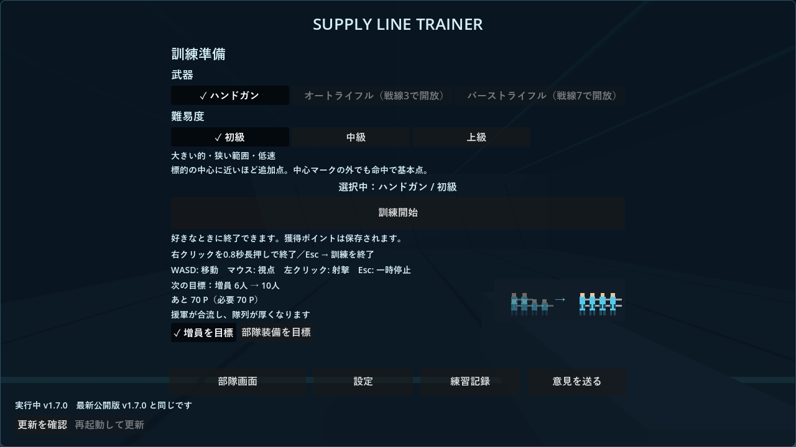
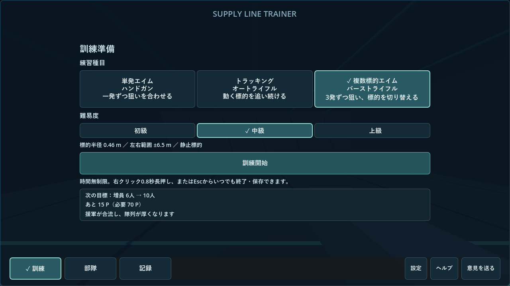
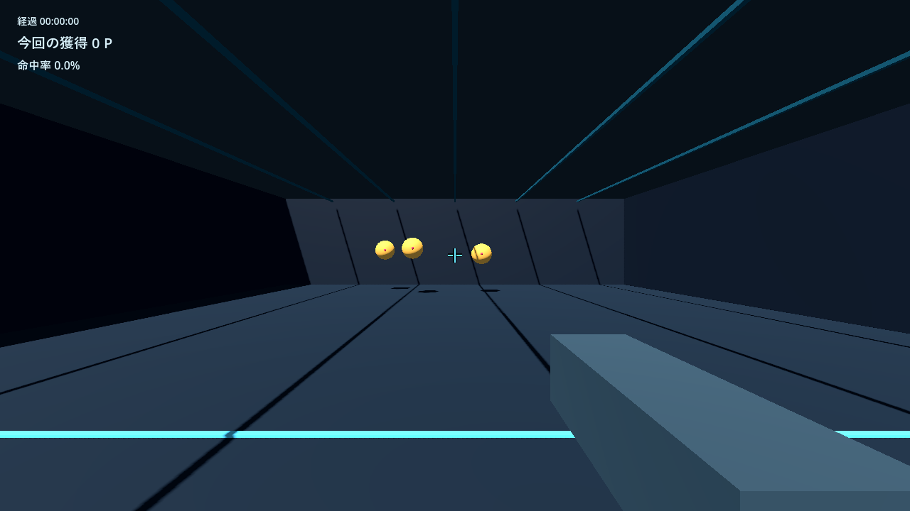
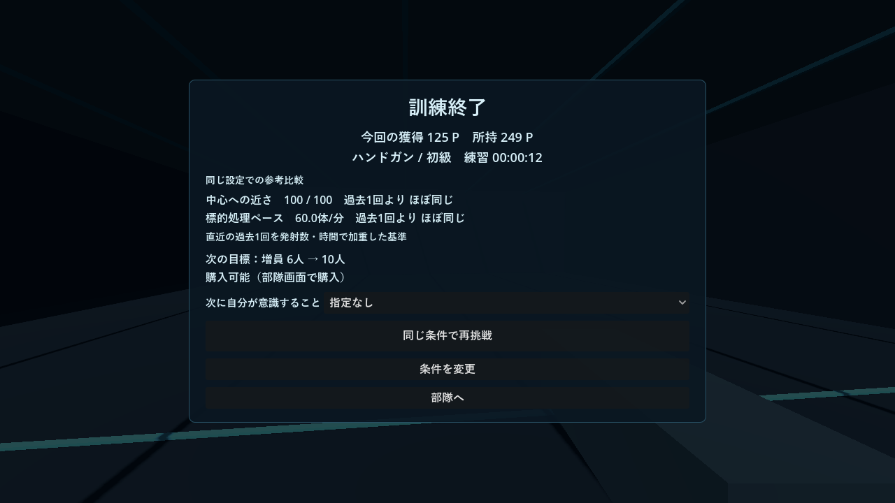
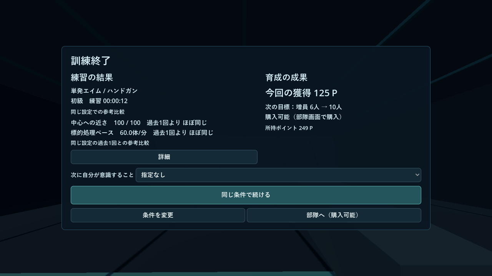

# 第一段階UI改善：v1.8.0検証結果

基準：v1.7.0、87b0e3e。開始時に未コミット変更・適用AGENTS.mdなしを確認し、README・変更履歴・前段の検証資料・採点／台帳／比較／設定／画面遷移を確認した。

アプリ内版番号は1.8.0。初めはローカル検証に限定し、2026-10-23の公開指示を受けてWindows配布版を`outputs/SupplyLineTrainer-v1.8.0-windows`へ作成した。最終配布PCKでも`stage1_tests.gd`を再実行し、保存テストも再確認した。第二段階は実装していない。

## 実装範囲

- `TrainingCatalog.available`をボタンと開始判定で共用し、全3種目を常時利用可能とした。武器IDは従来の0/1/2。新規の旧互換フラグは全true、旧セーブの有効な解放フラグはそのまま保持し、移行で消去しない。
- 「単発エイム」「トラッキング」「複数標的エイム」を主表示、従来の武器名を補助表示とした。バーストは1クリック3発・3命中処理・3標的という現行挙動なので、自由な1発切り替え練習と誤解させない名称に調整した。射撃自体は変えていない。
- 難度説明は既存の半径・左右範囲を読み、オートだけ移動の速さパラメーターを示す。静止種目へ移動速度の差を追加していない。
- 共通の「訓練／部隊／記録」ナビを画面下へ配置。設定・ヘルプ・フィードバックは補助。訓練・一時停止・結果ではナビを隠す。部隊内容は維持し、記録は共通ナビの余白を確保するため通常ページを6→5件にした。
- `TrainerTheme`でボタンの通常・ホバー・押下・無効・フォーカスと主操作を共通化。選択は枠・チェックでも示す。
- 準備は種目・難度・開始・小さな目標に整理。購入プレビューと目標変更操作は部隊へ集約。更新詳細は既存の設定へ集約し、準備には適用可能時だけ小さな案内を残す。
- 初回だけ短いスキップ可能案内を表示し、ヘルプは後から開ける。旧ユーザーに初回案内を強制しない。
- HUDの標準は時間・今回獲得・命中率（オートは既存追従率）。戦況ノードを作らず、戦闘処理は維持。カウントダウン・意識項目は左上に置き中央を塞がない。加点表示を0.7秒単位でまとめ、継続加点で得点文字を明滅させない。既存の命中音・音量・音選択は維持し、育成目標通知の追加音は外した。
- 設定「照準」へ`show_training_goal`（標準false）と`goal_notifications`（標準true）を追加。通知を無効にしても既存の達成済み状態を進め、結果から購入可能状態を確認できる。通知で訓練を停止しない。
- 結果を練習／育成の二領域に分け、保存済み比較の説明・条件は詳細パネルへ。主要操作は「同じ条件で続ける」、補助は「条件を変更」「部隊へ」で固定。任意の意識項目は維持。詳細を開く前に従来の台帳で精算済み。

## 保存と保護対象

選択を`selected_weapon`／`selected_difficulty`、案内を`help_seen`へ保存する。欠損・不正選択は0へ戻し、復元しても自動開始しない。旧データで案内フラグが欠ける場合は既存ユーザーとして案内済みを初期値とする。既存設定へ新UI設定の欠損値だけを補う。

採点v4・metrics v1・訓練ルールv1は不変。`Balance.score_and_reward`、台帳、ポイント端数、成績比較、射撃・標的・移動・感度・FOV・部隊価格・戦闘式を新システムへ置き換えていない。旧解放データを消す移行はない。実セーブの別名バックアップと専用領域へのコピーを使い、原本へテストを書き込んでいない。

## 実行した検証

- `stage1_save_tests`：新規／旧解放状態、旧記録・比較・進行保持、欠損／不正選択、新UI設定の保存再読込、旧ユーザーの案内抑制。
- `stage1_tests`：全練習の選択開始、開始／結果再開の連打、前回スコア・通知の消去、共通ナビ、非訓練画面のEsc、各画面から設定→未適用破棄→元画面復帰、HUDを外しても戦闘が進むこと、フォーカス停止・押しっぱなし抑止、詳細による二重精算なし、選択を実起動から復元しても準備に留まること。
- 通知無効で達成状態を保存再読込し、有効へ戻しても同じ通知が出ないこと。更新失敗で開始を妨げず、セーブ保護エラーでは理由を表示して開始を止めること。
- 1280×720／1920×1080／2560×1440で準備・HUD・結果・詳細・部隊・記録・設定・一時停止・ヘルプを実描画。指定クライアント寸法と画像寸法が一致し、主要ボタン・パネル・長押し表示・照準中央を範囲検査。大きなポイントと加点詳細オンの記録も隔離データ注入で確認した。これは実際の人の成績ではない。
- `scoring_regression_tests`：基準v1.7.0のmainを読み込み、3武器へ同じ固定乱数・実物理レイ入力を再生。stats・得点・内訳・端数・q合計／積分が完全一致。
- `metrics_capture`：実物理レイの射撃→結果→未選択再開→参考比較→意識選択→部隊購入→記録詳細→保存再読込を自動操作。バースト途中停止・撃破加点のq独立・一時停止・設定変更も確認。
- 既存`tests`、`practice_tests`、`metrics_tests`、`training_tests`、`ui_tests`、`growth_tests`、`battle_tests`、`purchase_effect_tests`、`reward_tests`、`reward_save_tests`、`save_compat_test`、`metrics_save_tests`、`updater_tests`が成功。
- 実セーブのコピーで、既存のポイント・端数・部隊・戦線・残耐久・設定・履歴・比較要約を保持する読込／保存／再読込と、原本不変を確認した。

自動操作にはOSからの偶発的なフォーカス／マウスイベントを分離し、必要な停止処理を明示再生している。人間が一連の入力を行った試遊とは区別する。旧移行が不要な現行セーブに昔の移行バックアップとの一致を要求していたテストは、必要な移行だけを検証するよう修正した。

## ローカルビルド

Godot 4.7.2 stable、GL Compatibility、NVIDIA GeForce RTX 4060。Windows EXEの起動と、同じPCKをGodotの`--main-pack`から読み込む外部自動操作で検証した。後者はコンパイル済みゲームコードを使うが、単体EXEを人が操作した試遊ではない。テスト・個人セーブ・画像・分析スクリプトはPCKから除外した。

システムDPIを設定変更なしで取得し96を確認（基準倍率100%）。他倍率へのWindows設定変更は実施していない。

## 未確認・懸念

確認範囲で未解決の重大な機能不具合はない。人間による操作感・視認性・満足感、別PC、高DPI／複数モニター、長時間試遊、旧版からの自動差し替え全経路は未確認。テスト成功だけで面白さや練習効果が改善したとは判断しない。

試遊時は旧版を終了してからローカルEXEを起動し、好きな練習をすぐ始められるか、HUDが邪魔でないか、結果から次の操作を迷わず選べるか、目標表示・通知の好みを設定できるかを確認する。第二段階の種目・地域・外見・報酬調整は今回実装していない。

## 画面例

