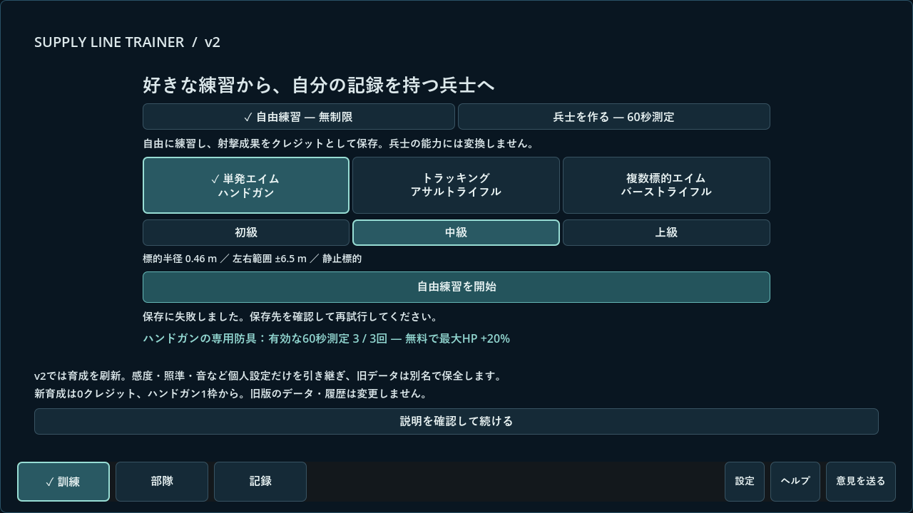
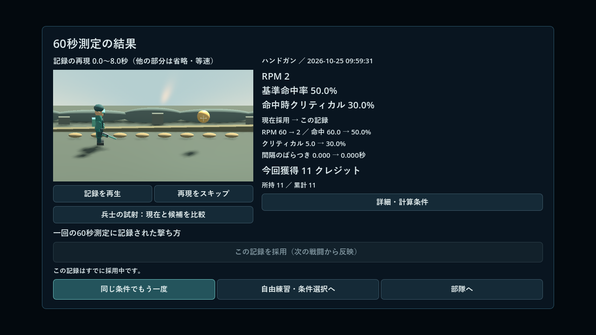
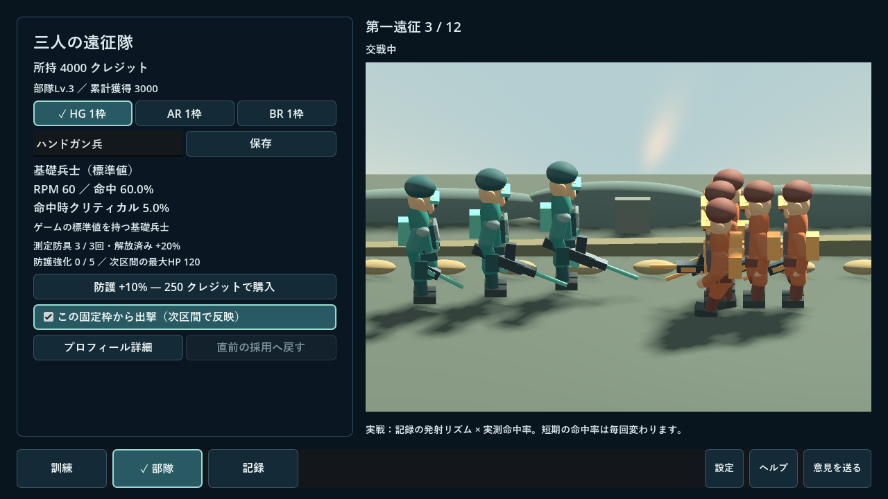

# v2.0.0 実装・検証報告

2026-10-25。開始基準は公開v1.9.0（`818ce15`）、作業ツリーはクリーン。使用済みv2.0.0タグ・配布はなく、旧タグ・ZIPを上書きしない。確定仕様は[v2仕様書](v2-spec.md)。

## 実装範囲

全3武器の自由練習、60秒測定、元記録から一回ごとのプロフィール変換、手動採用と直前への復帰、各武器1枠・最大3人、3回防具、有限5段階の防護、敵2種・12区間遠征・撤退・無料再挑戦・継続戦線、記録再現・任意の確率試射、3D兵士・戦場、新セーブと設定のみ移行を接続した。ハンドガン一兵士だけの途中版ではない。

旧大量増員、旧装備レベル、旧戦線・購入目標はv2の実行経路から外した。旧ソースと公開タグは履歴として保全。感度・FOV・クロスヘア・音・自由練習の採点v4と技能指標を再利用し、`v2_game.gd`が新ライフサイクルを担当する。測定収集・プロフィール・戦闘・再現・3D表示・保存は別ファイルとし、表示からダメージや成果を生成しない。

## 最終採用値と調整理由

仕様の初期値を`V2Rules`へ集中した。測定60秒・カウントダウン3秒、AR弾間隔0.1秒、バースト3発・弾間隔0.085秒、C=0.30Q、クリティカル倍率1.5は不変。基礎兵士HG60／AR300／BR180RPM、P0.60・C0.05も不変。実測プロフィールへ下限補正しない。

累計解放0／1,000／3,000、基礎HP100、3回防具+20%、防護各段+10%、費用250／500／900／1,400／2,000、弾威力10／2／4、軽装HP10・重装HP50は仕様値。第一遠征12区間と初期敵編成・攻撃値も不変。

測定用標的は半径0.42m、左右範囲±3.8m、固定位置[0,1.6,0]、距離11m、AR移動速度1.8を採用した。HG/BR配置はseed付き制約乱数で近／遠を約半分ずつにし、上下左右の出現数を抑制的に均す。各出現の同一難度までは保証しない。

統合・レビューで次を調整した。

- **測定ARの奥行きを11mに固定**：旧自由練習の奥行き変動をそのまま転用すると、測定では背面壁の奥へ標的が入るため。速度・左右範囲・半径は維持し、自由練習の動きは変更していない。測定条件と実際の表示位置を一致させた。
- **測定の解析的ray-sphere判定**：StaticBodyの物理座標が1tick古く、移動した表示中心への弾が外れ、HGの再配置前の場所へ2発目が当たる不具合を独立レビューで再現。測定だけ現在の球中心・半径へ最寄り正交差を計算し、qと着弾を同時に確定する。射場内の測定標的は遮蔽物のない固定範囲。自由練習の物理レイは不変。
- **入力到着時の有効時刻で発射**：描画フレームだけに頼ると同フレーム内ARタップが消えるため、入力到着時に前フレームからの有効時刻を進め、押下で初弾、解除前の予約弾だけを処理する。次の描画更新は入力で消費済みの時間を再加算しない。停止・復帰では時刻基準を更新し、60秒以降の入力は含めない。
- **継続戦線を同時12敵以内に制限**：初期案では13人目以降の見えない敵が攻撃し、モデルも蓄積したため。軽装を重装へ3区間ごとに置換し、重装上限8、合計12。第一遠征・価格・HPは変えず、継続戦線の編成だけを表示・処理可能範囲へ収めた。section12／13／50／10,000でも全敵を表示できる数に収まることを検査。

バランスは固定seedの合成記録によるシミュレーション。人の試遊ではない。基礎HG7区間、低命中4、中命中7、高命中10、HG＋基礎AR＋基礎BRは12区間、防具＋防護5の基礎HGは9区間まで進む例を確認。詳細条件・秒数は[中核報告](v2-contract.md)。自己ベスト更新以外にも加入・防護で進む余地を確認したが、全利用者の達成時間や面白さを保証しない。

## 使用モデルと独立レビュー

- 中核担当：明示指定した`gpt-6.1-sol`。測定、プロフィール、戦闘、台帳、移行、保存と中核テスト。
- 限定補助：`gpt-6-luna`。3D兵士・武器・防具・地形・表示イベントと描画テスト。判定・保存には触れない。
- 独立レビュー：別の`gpt-6.1-sol`。仕様全文と境界を読み、独立再現テストを追加。rootが統合・修正・配布を管理した。同じ主要ファイルを同時編集せず、レビューは補助実装後に実施。

Astraは使用していない。中核担当は一度利用上限で停止したが、続行指示後に同じSol担当を再開した。中核をLunaへ移していない。独立レビューは測定の物理tick遅れ、AR短入力、終了失敗時quit、見えない敵、標的・敵モデル蓄積、防具再現、抑制設定、試射の重複キー、測定前の標的先見えを指摘した。各修正後に再実行し、最終的に公開阻害指摘はすべて解消と確認された。

## 実行した検証

### 自動テスト・データ検証

- `v2_core_tests`：78項目。N/H/Q/RPM/P/Cの手計算、0発・全外れ・中心・端、版・中断・設定混在、同時刻順、30／60／120fps、10万試行の確率整合、位相・死亡・対象変更・再挑戦、3回目／4回目、防護、履歴205件後の採用元保全、移行・破損・保存失敗。
- `v2_integration_tests`：最終配布PCKで288項目。実射線3武器、60秒終端の途中バースト2発、位置固定、0発／途中終了除外、手動採用、未解放武器の採用保存、設定変更で新記録、同じ訓練への部隊往復、保存失敗で採用不変、1280×720／1920×1080／2560×1440の主要画面・操作範囲。
- `v2_boundary_tests`：最終配布PCKで26項目。同フレームARタップと連射の時刻列が30／60／120fpsで一致、入力flushの二重計時なし、60秒以降の入力除外、移動直後AR中心・HG即時再配置、80世代の再現標的と80区間のモデル保持数、継続敵上限、抑制、試射再開、再挑戦・継続保存失敗、終了保存失敗時の再試行、測定標的・入力・計時の同時開始。
- `scoring_regression_tests`：公開v1.9.0と同じ実射線を3武器へ再生し、自由練習のstats・得点・端数・q合計／積分が一致。
- `v2_migration_tests`：実セーブの別名バックアップと隔離コピーで、設定allowlistだけが移り、旧進行・履歴は入らず、原本・旧形式コピーのハッシュが不変。新進行の再保存・再読込も保持。
- `v2_persistence_tests`：配布PCKを別プロセスで2回起動。`is_test_mode=false`の通常保存処理で3武器の測定を完了し、手動採用操作・出撃・保存の後、再起動で完了回数各1・採用3件・履歴3件・獲得21クレジットを保持した。入力と有効時計はテストが自動駆動し、現実時間の試遊とは分ける。
- 独立`v2_review_tests`：指摘の再現後に修正版を再実行。13世代目の標的表示1・キャッシュ1、20区間モデルキャッシュ1、防具維持、抑制時効果0、AR移動直後q≈1、HG同tick2発目外れ、両ARタップ経路各1発、試射候補の演出再発生を確認。

### 実描画・動画・負荷

Windows／Godot4.7.2／NVIDIA GeForce RTX4060／OpenGL Compatibility。3解像度で準備、測定結果、部隊、プロフィール、記録、一時停止、設定を実描画・範囲検査し、画像を確認した。描画だけのheadlessテストと、実際のGPU描画は分けている。

名前・能力数値を隠した2種類の発射リズムの8秒比較AVIを作成した。保存された合成測定を等速で再現するもので、実ユーザーの記録でも、人が違いを識別できたという評価結果でもない。

VSync無効・1280×720・90フレームの参考値：測定中は中央値0.937ms／95%点1.929ms、部隊表示は4.543ms／7.514ms。フレーム待機とOS/GPUスケジューリングを含み、入力遅延の測定ではない。測定中の部隊SubViewportは`UPDATE_DISABLED`、アニメーション処理も停止していることを同時に確認した。

## 未確認・人の試遊で確認すること

人による長時間試遊、音の疲れにくさ、面白さ・本人らしさ、他FPSへの技能転移、別PC・高DPI・複数モニター、実電源断は未確認。確率試験や合成バランス例を、人の成績や効果実証へ読み替えない。

1. 同程度のRPMでも一定射撃と短連射・休止の違いが分かるか。
2. 再現の事実と、実戦の確率判定を区別できるか。
3. 三つの値とリズムを見て、採用する記録を自分で選べるか。
4. 3回防具・兵種加入・防護による変化と、練習へ戻る導線が分かるか。

Windows単体EXEの非表示起動と隔離保存の生成を確認した。今回の外部スクリプト引数を使った通常EXE起動では測定操作を実行できなかったため、測定から再読込までの自動操作は同梱PCKをGodotランタイムで実行して検証した。通常EXEを表示してのマウス操作・人による試遊は未実施。公開ZIP・更新検出の結果は下記に記載する。

公開後、ユーザーから画面表示・自動操作の許可を受け、別の隔離APPDATAで通常EXEを表示起動した。Computer Useは「Supply Line Trainer」のウィンドウを一意に検出したが、画面取得が`FrameArrived timed out: timed out waiting on channel`で失敗。ウィンドウを再取得して一度再試行した結果も`window capture timed out: timed out waiting on channel`だった。画面を確認できないためクリックは実行せず、自分が起動した隔離テストプロセスだけを終了した。表示起動の追加確認に留まり、通常EXEの「測定→採用→保存→再起動」を実操作確認済みとは扱わない。実ユーザーのデータは変更していない。

## 確認画像

隔離データと合成状態を用いた、配布PCKのGPU描画。実ユーザーの成績は含まない。

## 配布検証

`SupplyLineTrainer_Windows_v2.0.0.zip`は39,475,651バイト。SHA-256は`d5d40771f728877717340e6fc3b0fc8e90436446859530db67482d44a38d4f1d`。EXE/PCK・日本語README・CHANGELOG・Godotライセンスだけを同階層へ収録し、セーブ・テスト・画像を含めない。

更新機能のZIP検証がEXE/PCKの2点を受理した。実ZIPを別フォルダーへ展開し、両ファイルのハッシュが元ビルドと一致。展開したPCKでも通常保存経路の3武器測定・採用・出撃・保存・別プロセス再読込が通過した。

2026-10-25に[PUBLICリポジトリの正式版v2.0.0](https://github.com/cloford/supply-line-trainer/releases/tag/v2.0.0)を公開した。実装タグは`5b57b2cb0bc370468b7d2e111244b3c9d158fc6c`。旧タグ・配布物は上書きしていない。配布アセットは上記ZIPの1点で、GitHubのサイズ・SHA-256 digestがローカルと一致。draft=false、prerelease=false、最新版であることを確認した。

`public_release_tests`で公開APIから旧実行版v1.8.0→v2.0.0の更新を検出し、CDNへのリダイレクト・実ZIP取得・サイズ・SHA-256・ZIP内容が通過した。インストール・再起動は行っていない。配布PCKの`update_display_tests --live`でも実APIを使い、「実行中v2.0.0／最新公開版v2.0.0と同じ」、更新ボタン無効、720p・1080pの準備／設定の表示範囲を確認した（この最終表示テストはheadless）。旧配布版から実ファイルを差し替える自動更新の全工程は今回再実行していない。

[v2.0.0フィードバック](https://github.com/cloford/supply-line-trainer/discussions/8)を作成し、ゲーム内・README・リリースを同じ入口へ接続した。
